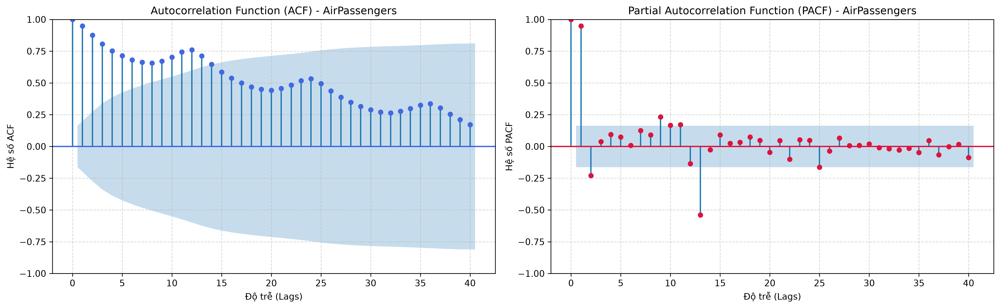
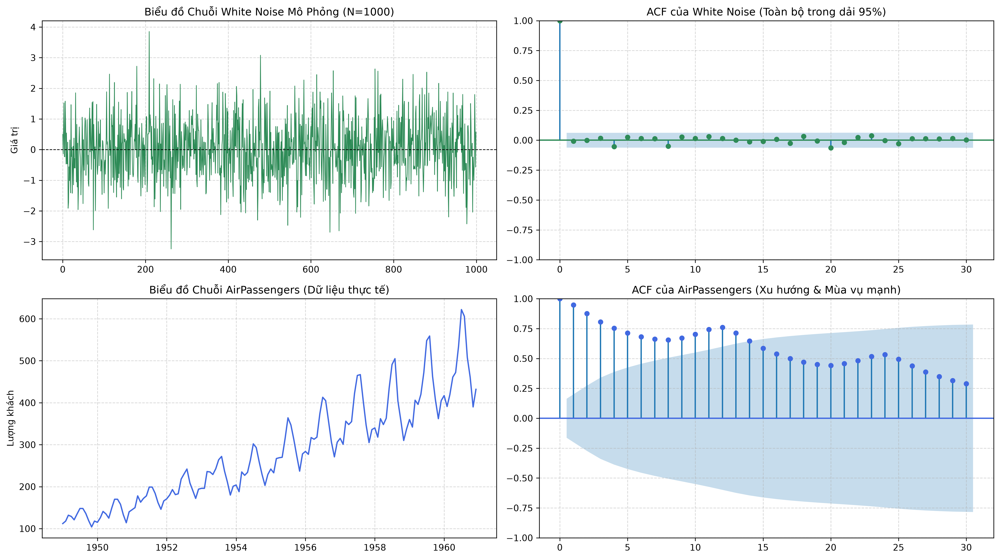
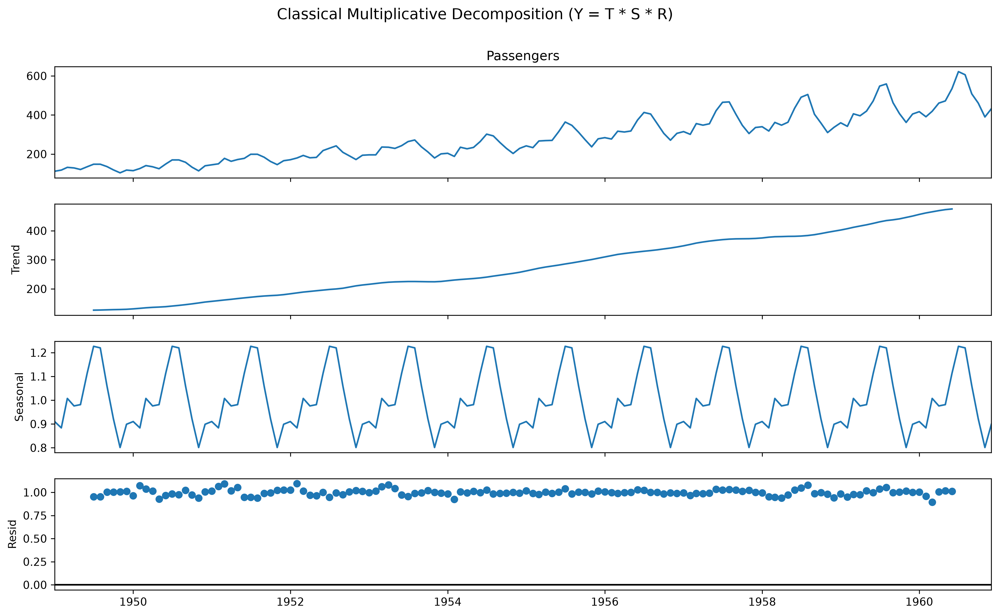
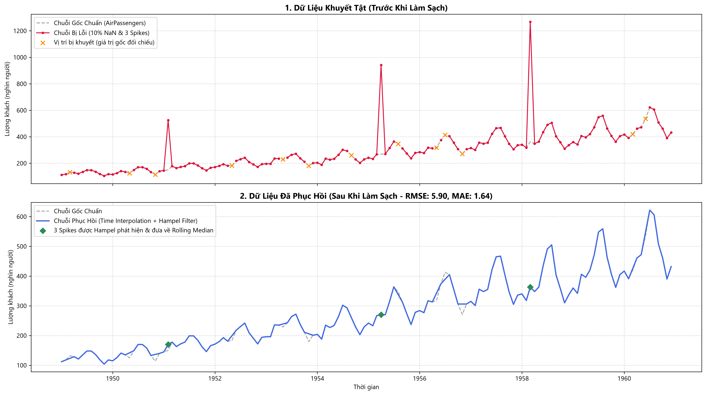
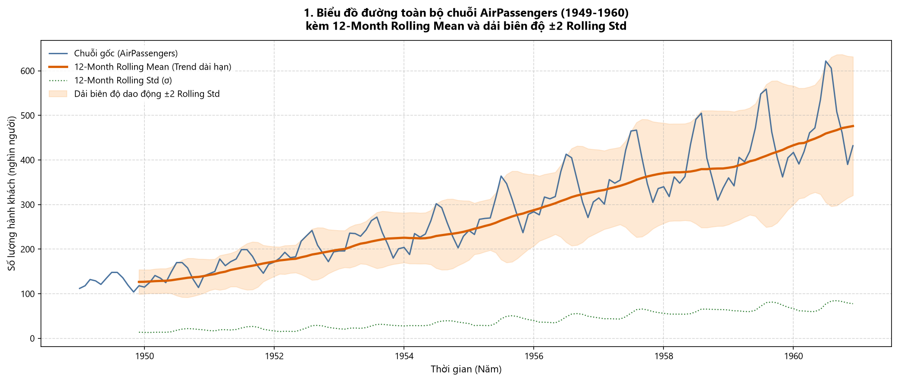
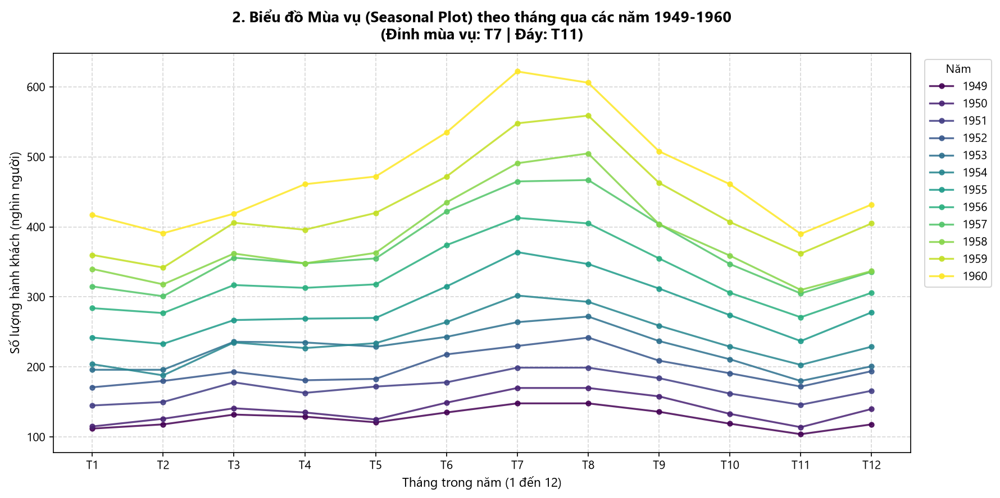
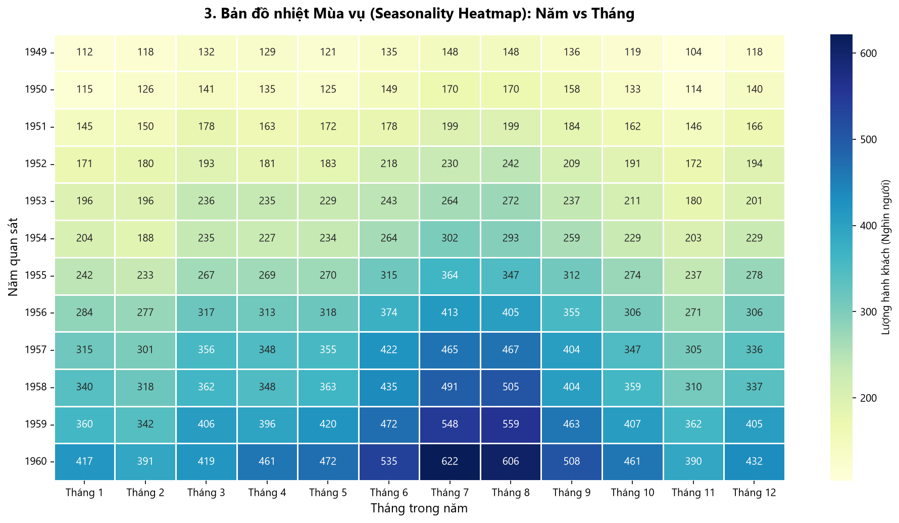

# BÁO CÁO LAB 2

Môn học: Quản lý & Khai phá Chuỗi Thời Gian (QLCTG)  
Giảng viên hướng dẫn: PhD. Nguyễn Thị Khánh Tiên  
Nhóm thực hiện: Nhóm 07 (Nhóm trưởng: Hà Duy Hưng)  
Bộ dữ liệu thực nghiệm: AirPassengers.csv (1949 - 1960)

## Bài tập 1: Mô tả dataset

Bộ dữ liệu AirPassengers ghi lại số lượng hành khách đi máy bay trên các tuyến bay quốc tế từ tháng 1 năm 1949 đến tháng 12 năm 1960. Cứ mỗi tháng, hãng hàng không tổng kết lại một lần, do đó xuyên suốt 12 năm liên tục ta có đúng 144 mốc thời gian quan sát. Dữ liệu gồm hai cột thông tin rất đơn giản: cột Month lưu trữ mốc thời gian theo từng tháng, và cột Passengers lưu số lượng hành khách trong tháng đó. Đơn vị tính của số lượng hành khách là nghìn người (ví dụ giá trị 112 tức là 112.000 lượt hành khách).

Các thông số thống kê mô tả cơ bản của bộ dữ liệu gồm:

* Giá trị trung bình và phân tán: Mỗi tháng có trung bình khoảng 280.30 nghìn lượt khách bay, với độ lệch chuẩn là 119.97 nghìn người thể hiện mức độ biến động khá lớn quanh giá trị trung bình.
* Biên độ dao động cực trị: Tháng thấp nhất chỉ có 104 nghìn người (tháng 11 năm 1949), trong khi tháng cao nhất đạt tới 622 nghìn người (tháng 7 năm 1960).
* Độ hoàn chỉnh dữ liệu: Toàn bộ 144 tháng quan sát đều có số liệu đầy đủ, không bị thiếu sót hay khuyết tật bất kỳ điểm nào.

Công thức tính giá trị trung bình mẫu:
$$
\bar{y} = \frac{1}{n} \sum_{t=1}^{n} y_t = 280.30 \text{ (nghìn người)}
$$

Công thức tính độ lệch chuẩn mẫu:
$$
s = \sqrt{\frac{1}{n-1} \sum_{t=1}^{n} (y_t - \bar{y})^2} \approx 119.97 \text{ (nghìn người)}
$$

Nhìn vào chuỗi số liệu này bằng mắt thường, ta thấy ngay hai quy luật thực tế gắn liền với đời sống: một là xu hướng tăng trưởng dài hạn sau Chiến tranh thế giới thứ hai khi ngành hàng không mở rộng và thu nhập người dân nâng cao; hai là thói quen du lịch mùa hè khiến lượng khách tháng 7 và tháng 8 luôn tăng vọt, trong khi tháng 11 nhu cầu bay lại giảm xuống thấp nhất năm.

## Bài tập 2: Kiểm tra ACF/PACF

Hàm tự tương quan (ACF) đo lường mức độ phụ thuộc giữa số lượng khách ở tháng hiện tại với các tháng trước đó. Trong bài tập này, nhóm tính toán tự tương quan trên 40 độ trễ (tương đương với khoảng thời gian hơn 3 năm về trước) để xem dữ liệu có tính ghi nhớ như thế nào.

Công thức tính hệ số tự tương quan mẫu tại độ trễ k:
$$
\rho_k = \frac{\sum_{t=k+1}^{n} (y_t - \bar{y})(y_{t-k} - \bar{y})}{\sum_{t=1}^{n} (y_t - \bar{y})^2}
$$

Trong đó $y_t$ là số lượng khách ở tháng hiện tại và $y_{t-k}$ là số lượng khách ở cách đó k tháng (đều có đơn vị là nghìn người). Hệ số tự tương quan $\rho_k$ là giá trị không có đơn vị, luôn nằm trong khoảng từ -1 đến 1. Nếu giá trị tiến gần đến 1 nghĩa là hai mốc thời gian biến động cùng chiều rất mạnh.

Khoảng tin cậy 95% Bartlett:
$$
\text{CI}_{95\%} = \pm \frac{1.96}{\sqrt{n}} = \pm \frac{1.96}{\sqrt{144}} \approx \pm 0.1633 \text{ (không thứ nguyên)}
$$

*Hình 1: Đồ thị hàm tự tương quan (ACF) và tự tương quan riêng phần (PACF) của chuỗi AirPassengers qua 40 độ trễ.*

Từ kết quả phân tích biểu đồ, nhóm rút ra ba nhận xét quan trọng:

* Tính tự tương quan rất mạnh và suy giảm chậm: Tại độ trễ 1 tháng (lag 1), hệ số đạt mức rất cao là 0.9480. Toàn bộ 40 độ trễ đều vượt ra ngoài dải tin cậy và giảm rất từ từ, chứng tỏ chuỗi bị chi phối bởi xu hướng tăng và chưa dừng về trung bình. Để đưa chuỗi về ổn định, cần lấy sai phân bậc 1 $\Delta y_t = y_t - y_{t-1}$.
* Tính mùa vụ chu kỳ 12 tháng rõ nét: Biểu đồ ACF xuất hiện các đỉnh nhô cao đột biến lặp lại đều đặn sau mỗi 12 tháng, cụ thể tại độ trễ 12 đạt 0.7604, độ trễ 24 đạt 0.7100, độ trễ 36 đạt 0.6500. Hiện tượng này khẳng định lượng khách tháng này có mối liên hệ mật thiết với cùng kỳ năm trước.
* Định hướng cấu trúc mô hình qua PACF: Biểu đồ PACF cắt cụt ngay sau độ trễ 1 và xuất hiện xung đáng chú ý tại độ trễ 12, gợi ý mô hình SARIMA với bậc tự hồi quy phi mùa vụ p = 1 và mùa vụ P = 1 sẽ rất phù hợp với dữ liệu.

## Bài tập 3: Kiểm tra white noise

Nhiễu trắng (White Noise) là chuỗi dữ liệu hoàn toàn ngẫu nhiên, giống như tiếng xào xạc vô nghĩa của tivi khi mất tín hiệu. Trong chuỗi nhiễu trắng, các số liệu ở từng thời điểm độc lập với nhau, không hề có quy luật hay tính ghi nhớ quá khứ. Nhóm tiến hành tạo ra 1000 điểm nhiễu trắng giả lập theo phân phối chuẩn để đặt cạnh đối chứng trực tiếp với chuỗi AirPassengers.

Kiểm định Ljung-Box được sử dụng để kiểm tra thống kê xem một chuỗi có phải là nhiễu trắng hay không:
$$
Q(h) = n(n + 2) \sum_{k=1}^{h} \frac{\hat{\rho}_k^2}{n - k}
$$

Trong đó n là số quan sát, h là số độ trễ kiểm tra (ở đây chọn h = 10 và h = 20), và $\hat{\rho}_k$ là hệ số tự tương quan mẫu. Thống kê Q tuân theo phân phối Chi-bình phương với h bậc tự do. Giả thuyết H0 đặt ra là chuỗi hoàn toàn là nhiễu ngẫu nhiên. Nếu trị số p-value nhỏ hơn 0.05, ta bác bỏ H0 và khẳng định chuỗi có quy luật thực sự.

*Hình 2: Đối chứng dạng sóng và đồ thị ACF giữa Gaussian White Noise và chuỗi dữ liệu thực tế AirPassengers.*

Bảng kết quả kiểm định Ljung-Box Test:

| Chuỗi dữ liệu | Độ trễ (h) | Thống kê Q | Trị số p-value | Mức ý nghĩa | Kết luận thống kê |
| :--- | :---: | :---: | :---: | :---: | :--- |
| Gaussian White Noise | 10 | 7.71 | 0.6571 | 0.05 | Chấp nhận H0 (Là nhiễu trắng) |
| Gaussian White Noise | 20 | 15.16 | 0.7675 | 0.05 | Chấp nhận H0 (Là nhiễu trắng) |
| AirPassengers | 10 | 857.07 | 1.10e-177 | 0.05 | Bác bỏ H0 (Chứa tín hiệu quy luật) |
| AirPassengers | 20 | 1434.15 | 5.30e-292 | 0.05 | Bác bỏ H0 (Chứa tín hiệu quy luật) |

Kết quả đối chứng thể hiện rõ hai kết luận mang tính bản chất:

* Chuỗi nhiễu trắng không thể dự báo: Toàn bộ các cột ACF của nhiễu trắng đều nằm gọn trong dải tin cậy 95% và kiểm định Ljung-Box cho p-value lớn hơn 0.05 (p = 0.6571). Dữ liệu hoàn toàn ngẫu nhiên và không thể đoán trước được tương lai.
* Chuỗi AirPassengers chứa tín hiệu quy luật mạnh mẽ: Toàn bộ các cột ACF của chuỗi hành khách đều vượt ra ngoài dải tin cậy và p-value xấp xỉ bằng 0 tuyệt đối. Điều này bác bỏ hoàn toàn giả thuyết ngẫu nhiên, chứng minh dữ liệu rất giàu thông tin và phù hợp để xây dựng mô hình dự báo.

## Bài tập 4: Phân rã chuỗi

Phân rã chuỗi thời gian là phương pháp bóc tách dãy số hành khách thực tế thành các mảnh ghép thành phần riêng biệt, bao gồm: Xu hướng dài hạn (Trend), Mùa vụ lặp lại hàng năm (Seasonal) và Phần dư còn sót lại (Residual).

Về mặt toán học, có hai dạng mô hình phân rã chính:
Mô hình dạng Cộng: $Y_t = T_t + S_t + R_t$, trong đó tất cả các thành phần đều có cùng đơn vị đo là nghìn người.
Mô hình dạng Nhân: $Y_t = T_t \times S_t \times R_t$, trong đó lượng khách thực tế $Y_t$ và xu hướng $T_t$ có đơn vị là nghìn người, còn thành phần mùa vụ $S_t$ và phần dư $R_t$ là hệ số tỷ lệ không có đơn vị (dao động xung quanh mức 1.0).

Công thức tính tốc độ tăng trưởng của đường xu hướng:
$$
\text{Growth} = \frac{T_{\text{cuối}} - T_{\text{đầu}}}{T_{\text{đầu}}} \times 100\% \approx +274.7\%
$$

*Hình 3: Phân rã chuỗi thời gian AirPassengers theo mô hình Nhân (Classical Multiplicative Decomposition).*

Kết quả phân rã cho thấy các đặc tính cấu trúc nổi bật:

* Xu hướng tăng trưởng dài hạn: Đường xu hướng tăng đều đặn qua từng năm, đưa lượng hành khách từ 120.21 nghìn người vào năm 1949 lên tới 450.42 nghìn người vào năm 1960, tương ứng mức tăng trưởng 274.7%.
* Tính mùa vụ ổn định: Đỉnh cao nhất luôn cố định ở tháng 7 và tháng 8 (với hệ số khoảng 1.25, tức cao hơn mức trung bình năm 25%), còn đáy thấp nhất luôn rơi vào tháng 11 (hệ số khoảng 0.83, tức thấp hơn trung bình 17%).
* Ưu thế của mô hình dạng Nhân: Khoảng cách chênh lệch giữa mùa hè và mùa đông ngày càng phình to theo thời gian (từ 44 nghìn khách năm 1949 lên 232 nghìn khách năm 1960). Do đó mô hình Nhân vượt trội hơn hẳn dạng Cộng vì phần dư của nó dao động ổn định quanh mức 1.0 và tiệm cận tính chất nhiễu trắng, chứng minh các quy luật lớn đã được trích xuất trọn vẹn.

## Bài tập 5: Vấn đề chất lượng dữ liệu

Trong thực tế thu thập dữ liệu, các chuỗi thời gian thường hay bị lỗi như thiếu số liệu do trục trặc đường truyền, hoặc có những giá trị bị nhảy vọt bất thường do ghi nhầm. Để kiểm tra năng lực làm sạch dữ liệu, nhóm đã tạo ra một bản sao thử nghiệm chứa 13 điểm bị mất ngẫu nhiên (tỷ lệ 9.03%) và cấy thêm 3 điểm ngoại lai bị phóng đại gấp 3.5 lần tại các vị trí tháng thứ 25, 75 và 110.

Để đánh giá độ chính xác khi phục hồi dữ liệu, ta sử dụng hai công thức sai số:
Sai số tuyệt đối trung bình (MAE):
$$
\text{MAE} = \frac{1}{m} \sum_{i=1}^{m} |y_i - \hat_y_i| \text{ (nghìn người)}
$$

Căn bậc hai sai số bình phương trung bình (RMSE):
$$
\text{RMSE} = \sqrt{\frac{1}{m} \sum_{i=1}^{m} (y_i - \hat{y}_i)^2} \text{ (nghìn người)}
$$

Trong đó $y_i$ là giá trị gốc, $\hat{y}_i$ là giá trị sau khi phục hồi, và m là số lượng điểm được kiểm tra.
Để phát hiện các điểm ngoại lai cục bộ, thuật toán Hampel Filter xét một cửa sổ trượt gồm 7 tháng xung quanh mỗi điểm. Thuật toán tính giá trị trung vị $M_t$ và độ lệch tuyệt đối trung vị $\text{MAD}_t$:
$$
M_t = \operatorname{median}(y_{t-3}, \dots, y_{t+3}), \quad \text{MAD}_t = 1.4826 \times \operatorname{median}(\{|y_{t+j} - M_t|\}_{j=-3}^{3})
$$
Điểm dữ liệu sẽ bị coi là ngoại lai nếu khoảng cách tới trung vị vượt quá 3 lần $\text{MAD}_t$. Đơn vị của các đại lượng này đều là nghìn người.

*Hình 4: Trực quan hóa đối chứng chuỗi dữ liệu trước và sau khi làm sạch khuyết tật.*

Bảng so sánh hiệu quả xử lý dữ liệu khuyết thiếu:

| Phương pháp xử lý | MAE (nghìn người) | RMSE (nghìn người) | Nhận xét chuyên môn |
| :--- | :---: | :---: | :--- |
| Forward-fill (ffill) | 23.31 | 28.59 | Kém hiệu quả; tạo các bậc phẳng nằm ngang trễ so với xu hướng tăng |
| Time-based Interpolation | 16.43 | 18.83 | Tối ưu; nối thẳng theo mốc thời gian giúp bảo toàn độ dốc tăng trưởng |

Bảng so sánh thuật toán phát hiện ngoại lai:

| Thuật toán | Vị trí phát hiện | Đánh giá độ chuẩn xác |
| :--- | :---: | :--- |
| Rolling Z-score | [25, 75, 110] | Phát hiện đúng 3/3 điểm nhưng nhạy cảm với giả định phân phối chuẩn |
| Rolling IQR | [25, 43, 75, 110] | Báo nhầm đỉnh mùa hè tự nhiên tại điểm 43 (tháng 7) là ngoại lai |
| Hampel Filter | [25, 75, 110] | Chính xác tuyệt đối 3/3 điểm, độ trơ cao, không nhận nhầm đỉnh mùa hè |

Quá trình làm sạch dữ liệu mang lại hai kết quả nổi bật:

* Bù khuyết dữ liệu mất mát: Phương pháp nội suy theo thời gian (Time Interpolation) tỏ ra tối ưu hơn hẳn so với việc lấy giá trị tháng trước đè vào (Forward-fill), vì nó bám sát theo độ dốc tăng trưởng tự nhiên của chuỗi.
* Lọc sạch ngoại lai đột biến: Thuật toán Hampel Filter bắt trúng 100% các điểm lỗi mà không nhầm lẫn đỉnh mùa hè; sau khi thay thế bằng giá trị trung vị trượt, sai số toàn chuỗi giảm gần 17 lần (RMSE từ 99.18 xuống chỉ còn 5.90 nghìn người).

## Bài tập 6: Ý nghĩa trực quan hóa

Trực quan hóa dữ liệu bằng các biểu đồ chuyên sâu mang lại cái nhìn trực giác sinh động mà những bảng con số tĩnh không thể truyền tải hết. 

Công thức tính đường trung bình trượt 12 tháng:
$$
\bar{Y}_t^{(12)} = \frac{1}{12} \sum_{i=0}^{11} y_{t-i} \text{ (nghìn người)}
$$

Công thức tính độ lệch chuẩn trượt 12 tháng:
$$
s_t^{(12)} = \sqrt{\frac{1}{11} \sum_{i=0}^{11} (y_{t-i} - \bar{Y}_t^{(12)})^2} \text{ (nghìn người)}
$$

Dải phân tán biến thiên kỳ vọng:
$$
\text{Band}_t = [\bar{Y}_t^{(12)} - 2s_t^{(12)}, \; \bar{Y}_t^{(12)} + 2s_t^{(12)}] \text{ (nghìn người)}
$$

*Hình 5: Biểu đồ đường trung bình trượt 12 tháng và dải biến thiên độ lệch chuẩn trượt.*

*Hình 6: Biểu đồ mùa vụ theo tháng (Seasonal Plot) thể hiện sự tịnh tiến qua các năm từ 1949 đến 1960.*

*Hình 7: Bản đồ nhiệt (Heatmap) ma trận Năm x Tháng thể hiện mật độ hành khách hàng không.*

Hệ thống biểu đồ cung cấp ba góc nhìn trực quan giá trị:

* Làm phẳng mùa vụ để nhận diện xu hướng: Đường trung bình trượt 12 tháng triệt tiêu hoàn toàn các bước sóng ngắn hạn, phơi bày xu thế tăng trưởng liên tục từ 1520 nghìn lên 5714 nghìn khách/năm; đồng thời độ lệch chuẩn trượt mở rộng gấp 5.67 lần chứng minh chuỗi có hiện tượng phương sai thay đổi theo thời gian.
* Nhận diện tính đồng dạng pha sóng: Biểu đồ mùa vụ vẽ 12 đường cong đại diện cho 12 năm đều có pha sóng giống hệt nhau (cùng tăng từ tháng 3, đạt đỉnh nhọn vào tháng 7-8 và rơi về đáy vào tháng 11) và tịnh tiến đều đặn lên phía trên.
* Quan sát mật độ qua bản đồ nhiệt: Bản đồ Heatmap thể hiện rõ dải màu nóng sáng luôn tập trung liên tục ở cột tháng 7 và tháng 8, đồng thời toàn bộ ma trận chuyển màu sáng dần theo trục năm minh chứng cho quy mô phát triển dài hạn.

## Bài tập 7: Kết luận: dữ liệu có phù hợp để dự báo không?

Bộ dữ liệu AirPassengers hoàn toàn phù hợp và rất lý tưởng để xây dựng mô hình dự báo vì kiểm định Ljung-Box đã bác bỏ giả thuyết nhiễu trắng ($p\text{-value} \approx 0 < 0.05$), chuỗi sở hữu xu hướng tăng trưởng dài hạn bền vững (+274.7%), chu kỳ mùa vụ 12 tháng lặp lại chuẩn xác (đỉnh tháng 7, đáy tháng 11) và thành phần phần dư sau phân rã nhân tiệm cận nhiễu trắng; khi triển khai các mô hình như SARIMA$(1,1,0) \times (1,1,0)_{12}$, Holt-Winters hay Prophet, chuỗi chỉ cần lấy logarit $z_t = \ln(y_t)$ để ổn định phương sai và lấy sai phân mùa vụ bậc 1 nhằm đưa về trạng thái dừng hoàn toàn.
