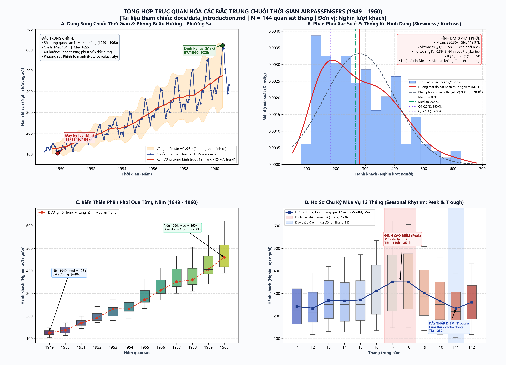

# TÀI LIỆU GIỚI THIỆU DỮ LIỆU THỰC NGHIỆM
## BỘ DỮ LIỆU AIRPASSENGERS (1949 - 1960)

---

## 1. NGUỒN GỐC VÀ BỐI CẢNH LỊCH SỬ

Bộ dữ liệu **AirPassengers** (thường được biết đến với tên gọi kinh điển *Box & Jenkins Airline Data*) là một trong những bộ dữ liệu chuẩn mực (benchmark dataset) nổi tiếng và có ảnh hưởng sâu rộng nhất trong lĩnh vực Thống kê ứng dụng và Khai phá Chuỗi Thời gian (Time Series Analysis & Forecasting).

- **Nguồn xuất bản gốc:** Được công bố và phân tích chuyên sâu lần đầu trong công trình nghiên cứu kinh điển của George E. P. Box và Gwilym M. Jenkins:
  > **Box, G. E. P., & Jenkins, G. M. (1976).** *Time Series Analysis: Forecasting and Control.* Holden-Day, San Francisco.
- **Bối cảnh thu thập:** Ghi nhận tổng số lượng hành khách trên các chuyến bay quốc tế của các hãng hàng không thương mại trong giai đoạn phục hồi và bùng nổ sau Chiến tranh thế giới thứ hai (thập niên 1950).
- **Vị trí lưu trữ trong dự án:**
  - Dữ liệu gốc (Raw): [`../data/raw/AirPassengers.csv`](../data/raw/AirPassengers.csv)
  - Dữ liệu chuẩn hóa (Processed): [`../data/processed/AirPassengers_resampled.csv`](../data/processed/AirPassengers_resampled.csv)

---

## 2. ĐẶC TẢ THUỘC TÍNH VÀ SCHEMA DỮ LIỆU

Bộ dữ liệu có cấu trúc đơn giản, tinh gọn nhưng phản ánh đầy đủ mọi đặc trưng phức tạp của chuỗi thời gian thực tế:

| Tên trường (Column) | Kiểu dữ liệu gốc | Kiểu dữ liệu chuẩn hóa | Đơn vị đo lường | Mô tả chi tiết |
| :--- | :---: | :---: | :---: | :--- |
| `Month` | `string` (`YYYY-MM`) | `pd.DatetimeIndex` (`freq='MS'`) | Tháng - Năm | Thời điểm quan sát bắt đầu từ ngày mùng 1 hàng tháng (`1949-01-01` đến `1960-12-01`). |
| `Passengers` | `int64` | `float64` | Nghìn lượt người ($10^3$) | Tổng lượng hành khách quốc tế di chuyển bằng đường hàng không trong tháng tương ứng (ví dụ: `112` tương đương $112,000$ hành khách). |

---

## 3. THỐNG KÊ MÔ TẢ ĐỊNH LƯỢNG

Trích xuất từ kết quả chạy thực nghiệm tại [`../outputs/tables/summary_statistics.csv`](../outputs/tables/summary_statistics.csv):

| Chỉ số thống kê | Ký hiệu toán học | Giá trị tính toán | Diễn giải ý nghĩa |
| :--- | :---: | :---: | :--- |
| **Số lượng quan sát (Count)** | $n$ | 144 | 144 tháng liên tục trong suốt 12 năm (1949 - 1960). |
| **Giá trị trung bình (Mean)** | $\bar{y}$ | 280.30 | Bình quân mỗi tháng có 280,300 lượt khách bay. |
| **Độ lệch chuẩn mẫu (Std)** | $s$ | 119.97 | Biên độ phân tán lớn quanh giá trị trung bình. |
| **Giá trị nhỏ nhất (Min)** | $y_{\min}$ | 104.00 | Đáy thấp kỷ lục vào Tháng 11/1949. |
| **Phân vị 25% (Q1)** | $Q_1$ | 180.00 | 25% số tháng có lượng khách dưới 180,000 người. |
| **Trung vị (Median / Q2)** | $\text{Med}$ | 265.50 | Điểm cân bằng của phân phối mẫu. |
| **Phân vị 75% (Q3)** | $Q_3$ | 360.50 | 75% số tháng có lượng khách dưới 360,500 người. |
| **Giá trị lớn nhất (Max)** | $y_{\max}$ | 622.00 | Đỉnh cao kỷ lục vào Tháng 07/1960. |
| **Hệ số bất đối xứng (Skewness)** | $\gamma_1$ | +0.5831 | Phân phối lệch dương nhẹ do xu hướng tăng trưởng liên tục. |
| **Độ nhọn (Kurtosis)** | $\gamma_2$ | -0.3650 | Đỉnh phân phối phẳng hơn so với phân phối chuẩn Gauss. |

### Tính toàn vẹn của chuỗi dữ liệu gốc:
- Số bản ghi bị thiếu (Missing/NaN): **0 / 144 (0.0%)** $\rightarrow$ Dữ liệu nguyên bản hoàn hảo 100%.
- Tính trùng lặp mốc thời gian (Duplicate timestamps): **0 bản ghi** $\rightarrow$ Chỉ mục thời gian đơn điệu tăng nghiêm ngặt.
- Tần suất quan sát: Đều đặn hàng tháng (`MS` - Month Start).

---

## 4. HÌNH ẢNH HÓA TRỰC QUAN ĐẶC TRƯNG DỮ LIỆU (DATA CHARACTERISTICS VISUALIZATION)

Nhằm cung cấp góc nhìn trực quan, khoa học và đối chứng trực tiếp với bảng thống kê mô tả định lượng ở Mục 3, toàn bộ 144 quan sát được trực quan hóa qua Dashboard 4 góc nhìn chuẩn mực tại [`../outputs/figures/data_characteristics_overview.png`](../outputs/figures/data_characteristics_overview.png):



*(Biểu đồ được tạo tự động bởi mô-đun: [`src/visualize_data_characteristics.py`](../src/visualize_data_characteristics.py))*

### Diễn giải chi tiết 4 góc nhìn trực quan:

1. **Panel A: Dạng sóng chuỗi thời gian & Phong bì Xu hướng - Phương sai (Waveform & Heteroskedasticity Envelope):**
   - **Đáy kỷ lục ($y_{\min} = 104$ nghìn khách, 11/1949):** Thời điểm lưu lượng khách quốc tế thấp nhất trong lịch sử thu thập dữ liệu.
   - **Đỉnh kỷ lục ($y_{\max} = 622$ nghìn khách, 07/1960):** Kỷ lục hành khách tăng gấp gần 6 lần sau 12 năm khai thác thương mại.
   - **Xu hướng tăng trưởng dài hạn (Upward Trend):** Đường trung bình trượt 12 tháng (12-MA) dốc lên liên tục phản ánh sự bùng nổ của ngành hàng không dân dụng hậu Thế chiến II.
   - **Hiện tượng phương sai thay đổi (Heteroskedasticity):** Vùng phong bì $\pm 1.96\sigma$ phình to từ $\pm 25$ nghìn (1949) lên đến hơn $\pm 130$ nghìn khách (1960), chứng minh độ biến động tỷ lệ thuận với mức trung bình và gợi ý sử dụng mô hình Nhân (Multiplicative).

2. **Panel B: Phân phối xác suất & Thống kê hình dạng (Distribution, Skewness & Kurtosis):**
   - **Độ lệch dương ($\gamma_1 = +0.5832$):** Phân phối có đuôi dài dạt về phía bên phải. Giá trị $\text{Mean} (280.30) > \text{Median} (265.50)$ là bằng chứng kinh điển của phân phối lệch phải do hiệu ứng kéo tăng trưởng của các năm cuối (1958 - 1960).
   - **Độ nhọn bẹt ($\gamma_2 = -0.3649$):** Hệ số Kurtosis âm (Platykurtic) cho thấy đỉnh phân phối thực tế bằng phẳng hơn so với phân phối chuẩn Gauss $\mathcal{N}(\mu, \sigma^2)$, dữ liệu trải đều trên dải rộng từ 104 đến 622.
   - **Khoảng tứ phân vị ($IQR = Q_3 - Q_1 = 360.5 - 180.0 = 180.5$ nghìn khách):** Bao phủ 50% quan sát trung tâm của chuỗi.

3. **Panel C: Biến thiên phân phối qua từng năm (Yearly Evolution Boxplots):**
   - Thể hiện sự tịnh tiến đi lên của đường trung vị từng năm (đường màu đỏ ngắt quãng) từ mức nền $\approx 125$ nghìn (năm 1949) vươn lên mốc $\approx 460$ nghìn (năm 1960).
   - Chiều cao của các hộp phân vị ($IQR$) mở rộng rõ rệt theo thời gian: từ chiếc hộp hẹp $\sim 40$ nghìn năm 1949 phình rộng lên $\sim 200$ nghìn năm 1960, khẳng định chuỗi vi phạm tính dừng ở cả Kỳ vọng (Mean) lẫn Phương sai (Variance).

4. **Panel D: Hồ sơ chu kỳ mùa vụ 12 tháng (12-Month Seasonal Profile):**
   - **Mùa cao điểm (Summer Peak - Tháng 7 & Tháng 8):** Lượng khách đạt đỉnh vượt trội với mức bình quân $\approx 350 - 351$ nghìn lượt người, trùng khớp với kỳ nghỉ hè và cao điểm du lịch quốc tế bán cầu Bắc.
   - **Mùa thấp điểm (Winter Trough - Tháng 11):** Lượng khách rơi vào điểm trũng sâu nhất trong năm với mức bình quân chỉ $\approx 232$ nghìn lượt người.
   - Biên độ dao động nội năm tạo thành mô hình hình sin lặp lại nhịp nhàng với chu kỳ $s = 12$ tháng.

---

## 5. QUYỀN SỞ HỮU TRÍ TUỆ VÀ ĐIỀU KHOẢN SỬ DỤNG

- **Bản quyền dữ liệu (License):** Bộ dữ liệu thuộc phạm vi **Miền công cộng (Public Domain / CC0: Public Domain Dedication)**.
- **Quyền sử dụng:**
  - Hoàn toàn tự do sử dụng cho mục đích giảng dạy, nghiên cứu khoa học, tái hiện thực nghiệm và phát triển mô hình.
  - Được phép tích hợp vào các gói thư viện mã nguồn mở (hiện được tích hợp sẵn trong `R` package `datasets`, Python `statsmodels`, `seaborn` và `sktime`).
- **Trích dẫn học thuật chuẩn mực (BibTeX):**
```bibtex
@book{boxjenkins1976,
  author    = {George E. P. Box and Gwilym M. Jenkins},
  title     = {Time Series Analysis: Forecasting and Control},
  publisher = {Holden-Day},
  address   = {San Francisco},
  year      = {1976},
  isbn      = {978-0816211043}
}
```

---

## 6. PHẠM VI ỨNG DỤNG TRONG LAB 2

Dữ liệu `AirPassengers` là hình mẫu lý tưởng để thực nghiệm các kỹ thuật:
1. **Kiểm tra tính dừng (Stationarity):** Chuỗi có xu hướng tăng rõ rệt và phương sai phình rộng dần theo thời gian (Heteroskedasticity), vi phạm tính dừng nghiêm trọng.
2. **Phân tích ACF/PACF:** Thể hiện đồng thời tính tự tương quan dương cực mạnh suy giảm chậm và các xung nhịp mùa vụ 12 tháng.
3. **Mô hình hóa phân rã:** Thử nghiệm đối chứng xuất sắc giữa mô hình Cộng và mô hình Nhân.
4. **Kiểm toán chất lượng dữ liệu:** Là môi trường đối chứng chuẩn (Ground Truth) để đánh giá độ chính xác của các thuật toán bù khuyết (Interpolation) và thuật toán lọc ngoại lai (Hampel Filter).

