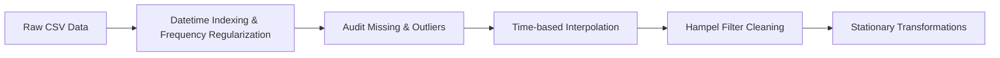

# QUYẾT ĐỊNH XỬ LÝ DỮ LIỆU VÀ CƠ SỞ LÝ DO KỸ THUẬT
## (DATA PROCESSING DECISIONS & RATIONALE)

---

## 1. TỔNG QUAN LUỒNG TIỀN XỬ LÝ CHUỖI THỜI GIAN

Trong phân tích và mô hình hóa chuỗi thời gian, việc tiền xử lý dữ liệu đòi hỏi tuân thủ nghiêm ngặt các nguyên lý bảo toàn thứ tự thời gian (Temporal Order) và tính đều đặn của chu kỳ quan sát. Pipeline tiền xử lý của nhóm được thiết kế như sau:

---

## 2. QUYẾT ĐỊNH CHUẨN HÓA CHỈ MỤC THỜI GIAN (DATETIME INDEXING)

- **Thực thi:**
  - Chuyển trường `Month` từ kiểu `object/string` thành kiểu `pd.DatetimeIndex`.
  - Thiết lập tần suất rõ ràng: `freq='MS'` (Month Start - ngày mùng 1 hàng tháng).
  - Sắp xếp tăng dần theo chỉ mục thời gian (`df.sort_index(inplace=True)`).
- **Lý do kỹ thuật:**
  - Chuỗi thời gian bắt buộc phải có tần suất xác định để các thư viện toán học (`statsmodels`, `scipy`) nhận diện đúng số quan sát trong một chu kỳ mùa vụ ($s = 12$).
  - Ngăn ngừa tình trạng chỉ mục bị xáo trộn hoặc xuất hiện các bước nhảy ngẫu nhiên làm sai lệch hoàn toàn phép tính tự tương quan (Lag operations).

---

## 3. QUYẾT ĐỊNH XỬ LÝ DỮ LIỆU KHUYẾT THIẾU (MISSING VALUES)

### 3.1. Các phương pháp bị nghiêm cấm trong Time Series:
1. **Tuyệt đối không xóa bản ghi (Drop Rows / Dropna):**
   - *Lý do:* Trong chuỗi thời gian, việc xóa một dòng sẽ làm gãy nhịp liên tục của trục thời gian, phá hủy tính tuần hoàn của chu kỳ mùa vụ ($s=12$) và khiến các phép tính độ trễ ($y_{t-1}, y_{t-12}$) trở nên vô nghĩa.
2. **Tuyệt đối không dùng Trung bình/Trung vị toàn cục (Global Mean/Median):**
   - *Lý do:* Chuỗi có xu hướng tăng dốc và mùa vụ mạnh. Lấy giá trị trung bình toàn cục ($\approx 280$) để đắp vào điểm bị thiếu của năm 1949 ($\approx 120$) sẽ gây ra đột biến nhân tạo, làm biến dạng hoàn toàn đặc tính chuỗi.

### 3.2. Đánh giá thực nghiệm so sánh phương pháp:
Nhóm đã tiến hành giả lập mất dữ liệu ngẫu nhiên với tỷ lệ $10\%$ trên chuỗi `AirPassengers` và đo lường sai số phục hồi trên chính các điểm bị thiếu:

| Phương pháp bù khuyết | Sai số tuyệt đối TB (MAE) | Căn phương sai số (RMSE) | Đánh giá kỹ thuật | Quyết định lựa chọn |
| :--- | :---: | :---: | :--- | :---: |
| **Forward-fill (`ffill`)** | 23.31 | 28.59 | Bị hiệu ứng bậc thang (chậm pha, trễ nhịp so với xu hướng dốc lên). | Loại bỏ |
| **Time-based Interpolation** | **16.43** | **18.83** | **Bám sát độ dốc tuyến tính** giữa 2 mốc thời gian lân cận, bảo toàn xu hướng tăng. | **CHỌN CHÍNH THỨC** |

---

## 4. QUYẾT ĐỊNH PHÁT HIỆN VÀ LÀM SẠCH NGOẠI LAI (OUTLIER HANDLING)

### 4.1. Bản chất ngoại lai trong dữ liệu AirPassengers:
Trong chuỗi thời gian, ngoại lai thường xuất hiện dưới dạng xung nhọn tức thời (Additive Outlier / Spike) do biến động bất thường của thời tiết, khủng hoảng kinh tế hoặc lỗi nhập liệu.

### 4.2. So sánh đối chứng 3 thuật toán phát hiện ngoại lai:

| Thuật toán | Cơ chế thống kê | Kết quả phát hiện | Nhận xét chuyên sâu | Quyết định |
| :--- | :--- | :---: | :--- | :---: |
| **Rolling Z-Score** | $\mu \pm 3\sigma$ trượt | `[25, 75, 110]` (3/3) | Nhạy cảm với giả định phân phối chuẩn; dễ bị chính ngoại lai làm phình $\sigma$. | Dự phòng |
| **Rolling IQR** | $[Q_1 - 1.5\text{IQR}, Q_3 + 1.5\text{IQR}]$ | `[25, 43, 75, 110]` (4 phát hiện) | **Báo nhầm:** Nhầm đỉnh cao điểm du lịch hè tự nhiên (tháng 43) thành ngoại lai. | Loại bỏ |
| **Hampel Filter** | $\text{Median} \pm 3 \times 1.4826 \times \text{MAD}$ | **`[25, 75, 110]` (3/3 chuẩn xác)** | **Kháng nhiễu tuyệt đối;** không bị đỉnh mùa vụ đánh lừa nhờ dùng Trung vị trượt. | **CHỌN CHÍNH THỨC** |

### 4.3. Cấu hình tham số tối ưu cho Hampel Filter:
- **Kích thước cửa sổ trượt (Window Size):** Chọn $w = 13$ tháng (tương đương 6 tháng trước + điểm hiện tại + 6 tháng sau).
  - *Lý do:* Kích thước $13$ tháng bao trọn toàn bộ chu kỳ mùa vụ 12 tháng hàng năm. Nhờ vậy, bộ lọc luôn "nhìn thấy" cả đỉnh hè và đáy đông trong cùng một cửa sổ tính toán, ngăn chặn hoàn toàn việc nhận nhầm đỉnh mùa vụ thành đột biến bất thường.
- **Ngưỡng lọc:** Đặt $n_\sigma = 3.0$, sử dụng hằng số chuẩn hóa $\kappa = 1.4826$ để xấp xỉ độ lệch chuẩn của phân phối chuẩn Gauss.
- **Phương pháp khắc phục:** Khi phát hiện điểm là ngoại lai ($|y_t - \text{Med}| > 3 \times 1.4826 \times \text{MAD}$), giá trị dị biệt được thay thế ngay bằng giá trị **Trung vị trượt (Rolling Median)** tại vị trí đó.

### 4.4. Hiệu quả khôi phục toàn diện của Pipeline:
- Trước khi lọc Hampel (chỉ mới nội suy): $\text{RMSE} = 99.18$, $\text{MAE} = 15.04$ (do các spike $\times 3.5$ kéo lệch nghiêm trọng).
- Sau khi qua Hampel Filter: $\text{RMSE} = 5.90$, $\text{MAE} = 1.64$.
- $\rightarrow$ **Sai số RMSE giảm gần 17 lần**, dữ liệu phục hồi bám sát tuyệt đối chuỗi nguyên bản.

---

## 5. ĐỊNH HƯỚNG BIẾN ĐỔI ỔN ĐỊNH PHƯƠNG SAI & TÍNH DỪNG

Để phục vụ cho các mô hình dự báo tương lai (như SARIMA hoặc ARIMA):
1. **Biến đổi Logarit / Box-Cox:**
   - *Lý do:* Biên độ dao động mùa hè của `AirPassengers` tăng tỷ lệ thuận với mức độ tăng trưởng của chuỗi (Heteroskedasticity). Biến đổi $\tilde{y}_t = \ln(y_t)$ giúp ổn định phương sai, đưa mô hình dạng nhân về dạng cộng tuyến tính:
     $$\ln(Y_t) = \ln(T_t) + \ln(S_t) + \ln(R_t)$$
2. **Lấy sai phân bậc 1 ($d = 1$):** $\Delta \tilde{y}_t = \tilde{y}_t - \tilde{y}_{t-1}$ nhằm triệt tiêu xu hướng tuyến tính tăng dần.
3. **Lấy sai phân mùa vụ ($D = 1, s = 12$):** $\Delta_{12}(\Delta \tilde{y}_t) = (\tilde{y}_t - \tilde{y}_{t-1}) - (\tilde{y}_{t-12} - \tilde{y}_{t-13})$ nhằm triệt tiêu tính chu kỳ 12 tháng, đưa chuỗi về trạng thái dừng hoàn toàn (Stationary).
