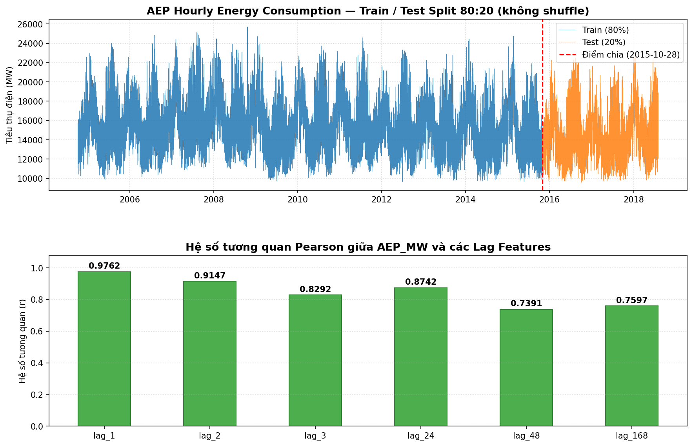
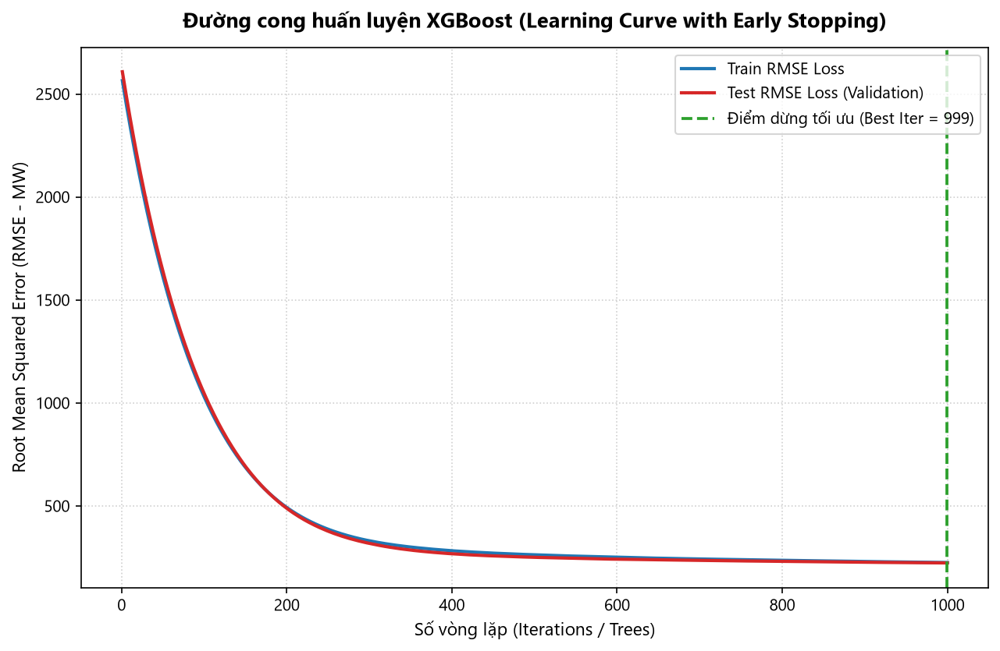
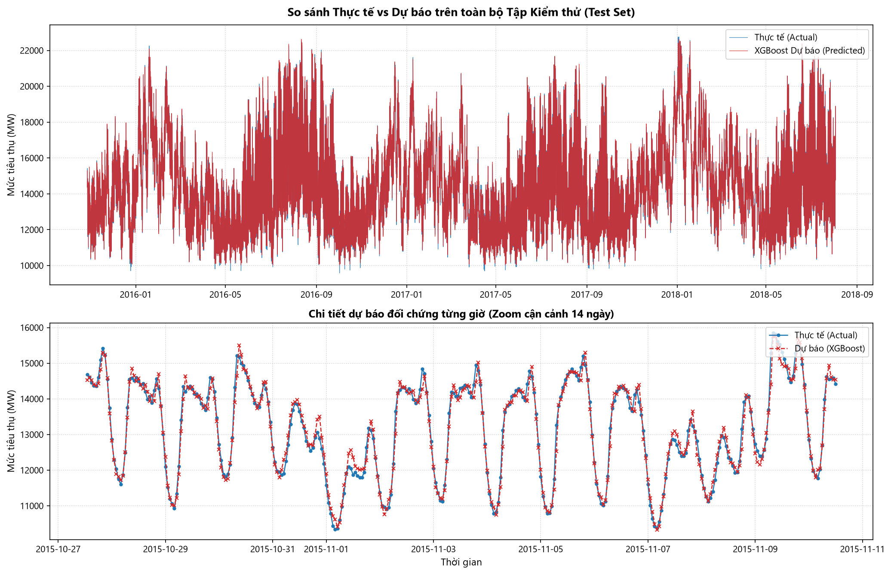
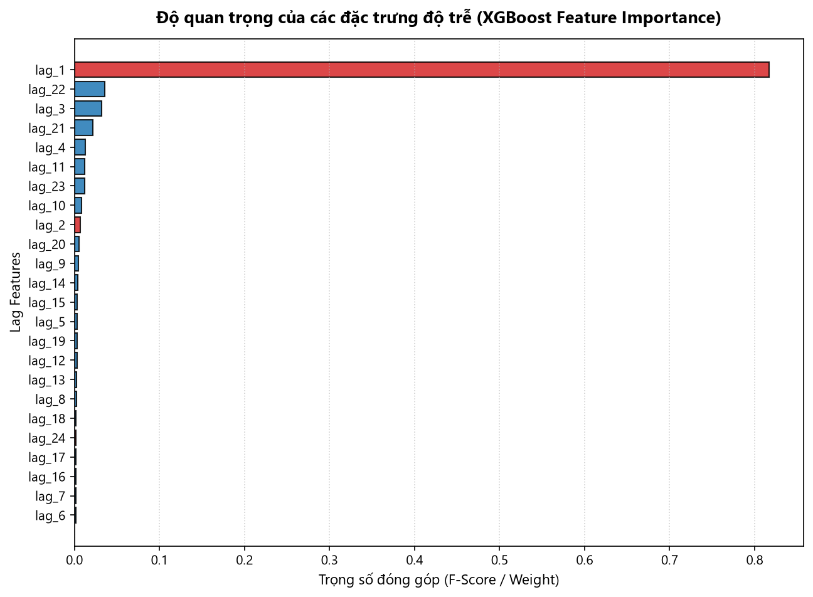
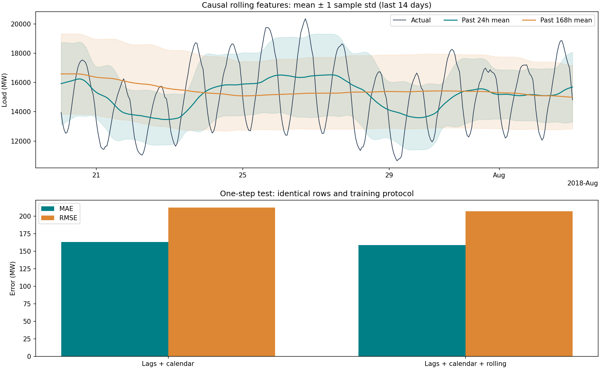
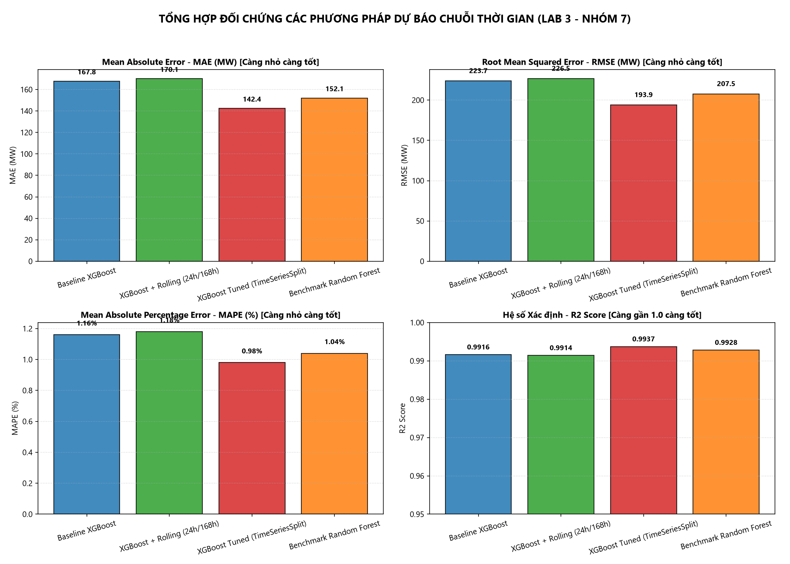

# BÁO CÁO KỸ THUẬT LAB 3 – NHÓM 7

**Chủ đề:** Dự báo chuỗi thời gian tiêu thụ điện bằng XGBoost Regressor

**Nhiệm vụ:** CV06 – Kiểm toán pipeline, tổng hợp kết quả và trả lời lý thuyết

## 1. Mục tiêu

Biến chuỗi thời gian thành bài toán học có giám sát với lag/calendar/rolling features; tổng hợp các kết quả CV01–CV05 và kiểm tra khả năng tái lập.

## 2. Dữ liệu và tiền xử lý (CV01)

| Chỉ số | Giá trị |
| --- | --- |
| Tên tệp dữ liệu gốc | AEP_hourly.csv |
| Mốc thời gian bắt đầu | 2004-10-01 01:00:00 |
| Mốc thời gian kết thúc | 2018-08-03 00:00:00 |
| Tổng số quan sát thô | 121,273 |
| Số bản ghi trùng lặp (DST) | 4 |
| Số quan sát sau làm sạch | 121,269 |
| Số lượng giá trị khuyết thiếu (NaN) | 0 |
| Mức tiêu thụ trung bình (Mean MW) | 15499.65 |
| Độ lệch chuẩn (Std MW) | 2591.32 |
| Mức tiêu thụ nhỏ nhất (Min MW) | 9581.00 |
| Phân vị 25% (Q1 MW) | 13630.00 |
| Trung vị 50% (Median MW) | 15310.00 |
| Phân vị 75% (Q3 MW) | 17200.00 |
| Mức tiêu thụ lớn nhất (Max MW) | 25695.00 |

## 3. Huấn luyện baseline (CV02)

| iteration | train_rmse | test_rmse |
| --- | --- | --- |
| 0 | 2565.27 | 2609.53 |
| 1 | 2540.63 | 2584.75 |
| 2 | 2516.23 | 2560.21 |
| 3 | 2492.09 | 2535.92 |
| 4 | 2468.19 | 2511.88 |

## 4. Đánh giá mô hình (CV03)

| metric | value | unit |
| --- | --- | --- |
| MAE | 161.616 | MW |
| RMSE | 211.923 | MW |
| MAPE | 1.11347 | % |
| R2 | 0.992489 | score |

### Feature importance

| rank | feature | importance | feature_type |
| --- | --- | --- | --- |
| 1 | lag_1 | 0.918705 | lag |
| 2 | lag_3 | 0.0152096 | lag |
| 3 | hour | 0.0146509 | calendar |
| 4 | lag_24 | 0.0139332 | lag |
| 5 | lag_2 | 0.0112615 | lag |
| 6 | lag_168 | 0.00979869 | lag |
| 7 | dayofweek | 0.00545694 | calendar |
| 8 | month | 0.0038481 | calendar |
| 9 | dayofyear | 0.0027568 | calendar |
| 10 | quarter | 0.00222709 | calendar |
| 11 | lag_48 | 0.00146326 | lag |
| 12 | year | 0.000688889 | calendar |
| 13 | is_weekend | 0 | calendar |

## 5. Rolling features và dự báo đa bước (CV04)

| strategy | scope | n | MAE | RMSE | MAPE_pct | WAPE_pct | R2 | Bias_MW | Median_AE | P90_AE | P95_AE | Max_AE |
| --- | --- | --- | --- | --- | --- | --- | --- | --- | --- | --- | --- | --- |
| Direct | all | 24144 | 568.33 | 772.732 | 3.91079 | 3.86105 | 0.900235 | 108.967 | 414.257 | 1287.38 | 1659.11 | 3923.22 |
| Recursive | all | 24144 | 613.825 | 847.288 | 4.16027 | 4.17013 | 0.880055 | 20.2522 | 435.806 | 1421.39 | 1812.57 | 4869.24 |
| SeasonalNaive168 | all | 24144 | 1435.36 | 1909.36 | 9.62868 | 9.75137 | 0.390893 | -16.6135 | 1084 | 3260 | 3975.85 | 8276 |
| SeasonalNaive24 | all | 24144 | 922.171 | 1222.53 | 6.25031 | 6.26493 | 0.750288 | -3.75783 | 688.5 | 2061.7 | 2547.85 | 7656 |

### Sai số theo horizon

| horizon | n_origins | MAE | RMSE | cumulative_MAE | cumulative_RMSE |
| --- | --- | --- | --- | --- | --- |
| 1 | 1006 | 135.622 | 173.149 | 135.622 | 173.149 |
| 2 | 1006 | 291.876 | 372.704 | 213.749 | 290.593 |
| 3 | 1006 | 412.434 | 525.656 | 279.977 | 385.229 |
| 4 | 1006 | 464.669 | 602.516 | 326.15 | 449.508 |
| 5 | 1006 | 498.299 | 648.625 | 360.58 | 495.771 |
| 6 | 1006 | 545.507 | 701.228 | 391.401 | 535.516 |
| 7 | 1006 | 566.917 | 731.708 | 416.475 | 567.71 |
| 8 | 1006 | 565.424 | 745.298 | 435.094 | 592.825 |
| 9 | 1006 | 572.638 | 770.087 | 450.376 | 615.049 |
| 10 | 1006 | 595.915 | 813.415 | 464.93 | 637.668 |
| 11 | 1006 | 624.238 | 859.909 | 479.413 | 660.967 |
| 12 | 1006 | 645.679 | 897.746 | 493.268 | 683.837 |
| 13 | 1006 | 660.597 | 928.381 | 506.14 | 705.663 |
| 14 | 1006 | 678.952 | 961.712 | 518.483 | 726.95 |
| 15 | 1006 | 741.846 | 1039.74 | 533.374 | 751.862 |
| 16 | 1006 | 758.144 | 1059.7 | 547.422 | 774.694 |
| 17 | 1006 | 725.927 | 985.332 | 557.923 | 788.643 |
| 18 | 1006 | 691.313 | 913.664 | 565.333 | 796.104 |
| 19 | 1006 | 676.192 | 884.405 | 571.168 | 800.994 |
| 20 | 1006 | 699.409 | 907.753 | 577.58 | 806.668 |
| 21 | 1006 | 737.238 | 956.01 | 585.183 | 814.401 |
| 22 | 1006 | 783.916 | 1010.82 | 594.216 | 824.345 |
| 23 | 1006 | 814.595 | 1048.03 | 603.798 | 835.317 |
| 24 | 1006 | 844.448 | 1086.83 | 613.825 | 847.288 |

## 6. Tinh chỉnh và benchmark (CV05)

_Chưa có dữ liệu trong repository._

### Benchmark CV05

_Chưa có dữ liệu trong repository._

## 7. Ba câu hỏi lý thuyết

### Câu 1. XGBoost so với Linear Regression

Linear Regression mô hình hóa mục tiêu bằng tổ hợp tuyến tính của các đặc trưng, dễ giải thích và là baseline nhanh. Nhưng quan hệ phi tuyến hoặc tương tác giữa lag và biến lịch chỉ được mô tả nếu chủ động thêm biến đổi/tương tác. Các lag thường tương quan mạnh, gây đa cộng tuyến và làm hệ số kém ổn định; Ridge/Lasso có thể giảm vấn đề này.

XGBoost kết hợp nhiều cây quyết định nên học được ngưỡng phi tuyến và tương tác tự động, hữu ích khi quan hệ giữa tải điện, giờ, ngày trong tuần và lịch sử phức tạp. Đổi lại, mô hình khó diễn giải hơn và dễ quá khớp nếu cây quá sâu hoặc đánh giá sai cách. XGBoost cũng không ngoại suy xu hướng ngoài miền huấn luyện tốt như một mô hình tuyến tính có xu hướng phù hợp; dự đoán cây thường bị giới hạn theo giá trị lá. Cần lựa chọn bằng validation theo thời gian, không chỉ dựa vào độ phức tạp.

### Câu 2. Tác động khi tăng số lượng lag p

Tăng p giúp mô hình sử dụng lịch sử dài hơn. Với chuỗi theo giờ, lag 24 có thể biểu diễn chu kỳ ngày và lag 168 biểu diễn chu kỳ tuần. Tuy nhiên, nhiều lag làm tăng số chiều, chi phí tính toán và tương quan giữa đặc trưng; mô hình có thể học nhiễu khi dữ liệu hữu hiệu không đủ lớn. Lag lớn nhất cũng làm mất các quan sát đầu chuỗi do thiếu lịch sử. Nên chọn lag dựa trên hiểu biết miền, ACF/PACF và ablation, rồi đánh giá trên các lát thời gian chưa thấy; không mặc định càng nhiều lag càng tốt.

### Câu 3. Khi nào XGBoost phù hợp hơn ARIMA/SARIMA?

XGBoost thường có lợi khi chuỗi có phi tuyến, tương tác phức tạp, nhiều biến ngoại sinh như thời tiết/lịch nghỉ, nhiều đặc trưng lịch hoặc rolling, và dữ liệu đủ lớn. ARIMA/SARIMA phù hợp làm mô hình thống kê khi chuỗi đơn biến có cấu trúc tuyến tính và tự tương quan/mùa vụ tương đối rõ, đồng thời dễ diễn giải. XGBoost không tự hiểu thứ tự thời gian nên cần tạo lag và đặc trưng đúng cách. So sánh công bằng phải dùng cùng tập kiểm tra, horizon và thước đo; nên có baseline mùa vụ y(t-24) hoặc y(t-168). Không nên kết luận XGBoost tốt hơn ARIMA/SARIMA nếu nhóm chưa chạy thực nghiệm đối sánh trực tiếp.

## 8. Kiểm toán pipeline

- Bảng hiện có: 5/7; thiếu: cv05_best_hyperparameters.csv, cv05_benchmark_summary.csv.

- Hình hiện có: 6/7; thiếu: cv05_benchmark_comparison.png.

### Kiểm tra chống data leakage
1. Chia train/validation/test theo thời gian, không shuffle.
2. Rolling features chỉ dùng dữ liệu quá khứ (shift trước rolling).
3. Không chọn tham số hoặc early stopping bằng tập test cuối.
4. Đối chiếu mô hình trên cùng horizon và cùng metric.

## 9. Bảng chỉ số hợp nhất

| source | model | scope | metric | value | unit |
| --- | --- | --- | --- | --- | --- |
| cv03_evaluation_metrics.csv | XGBoost baseline | one-step test | MAE | 161.616 | MW |
| cv03_evaluation_metrics.csv | XGBoost baseline | one-step test | RMSE | 211.923 | MW |
| cv03_evaluation_metrics.csv | XGBoost baseline | one-step test | MAPE | 1.11347 | % |
| cv03_evaluation_metrics.csv | XGBoost baseline | one-step test | R2 | 0.992489 | score |
| cv04_strategy_summary.csv | Direct | all | MAE | 568.33 | MW |
| cv04_strategy_summary.csv | Direct | all | RMSE | 772.732 | MW |
| cv04_strategy_summary.csv | Direct | all | MAPE_pct | 3.91079 | % |
| cv04_strategy_summary.csv | Direct | all | WAPE_pct | 3.86105 | % |
| cv04_strategy_summary.csv | Direct | all | R2 | 0.900235 | score |
| cv04_strategy_summary.csv | Direct | all | Bias_MW | 108.967 | MW |
| cv04_strategy_summary.csv | Recursive | all | MAE | 613.825 | MW |
| cv04_strategy_summary.csv | Recursive | all | RMSE | 847.288 | MW |
| cv04_strategy_summary.csv | Recursive | all | MAPE_pct | 4.16027 | % |
| cv04_strategy_summary.csv | Recursive | all | WAPE_pct | 4.17013 | % |
| cv04_strategy_summary.csv | Recursive | all | R2 | 0.880055 | score |
| cv04_strategy_summary.csv | Recursive | all | Bias_MW | 20.2522 | MW |
| cv04_strategy_summary.csv | SeasonalNaive168 | all | MAE | 1435.36 | MW |
| cv04_strategy_summary.csv | SeasonalNaive168 | all | RMSE | 1909.36 | MW |
| cv04_strategy_summary.csv | SeasonalNaive168 | all | MAPE_pct | 9.62868 | % |
| cv04_strategy_summary.csv | SeasonalNaive168 | all | WAPE_pct | 9.75137 | % |
| cv04_strategy_summary.csv | SeasonalNaive168 | all | R2 | 0.390893 | score |
| cv04_strategy_summary.csv | SeasonalNaive168 | all | Bias_MW | -16.6135 | MW |
| cv04_strategy_summary.csv | SeasonalNaive24 | all | MAE | 922.171 | MW |
| cv04_strategy_summary.csv | SeasonalNaive24 | all | RMSE | 1222.53 | MW |
| cv04_strategy_summary.csv | SeasonalNaive24 | all | MAPE_pct | 6.25031 | % |
| cv04_strategy_summary.csv | SeasonalNaive24 | all | WAPE_pct | 6.26493 | % |
| cv04_strategy_summary.csv | SeasonalNaive24 | all | R2 | 0.750288 | score |
| cv04_strategy_summary.csv | SeasonalNaive24 | all | Bias_MW | -3.75783 | MW |
| cv04_multistep_metrics.csv | Recursive | horizon=1.0 | MAE | 135.622 | MW |
| cv04_multistep_metrics.csv | Recursive | horizon=1.0 | RMSE | 173.149 | MW |
| cv04_multistep_metrics.csv | Recursive | horizon=2.0 | MAE | 291.876 | MW |
| cv04_multistep_metrics.csv | Recursive | horizon=2.0 | RMSE | 372.704 | MW |
| cv04_multistep_metrics.csv | Recursive | horizon=3.0 | MAE | 412.434 | MW |
| cv04_multistep_metrics.csv | Recursive | horizon=3.0 | RMSE | 525.656 | MW |
| cv04_multistep_metrics.csv | Recursive | horizon=4.0 | MAE | 464.669 | MW |
| cv04_multistep_metrics.csv | Recursive | horizon=4.0 | RMSE | 602.516 | MW |
| cv04_multistep_metrics.csv | Recursive | horizon=5.0 | MAE | 498.299 | MW |
| cv04_multistep_metrics.csv | Recursive | horizon=5.0 | RMSE | 648.625 | MW |
| cv04_multistep_metrics.csv | Recursive | horizon=6.0 | MAE | 545.507 | MW |
| cv04_multistep_metrics.csv | Recursive | horizon=6.0 | RMSE | 701.228 | MW |

## 10. Hình minh họa

### cv01_raw_and_lags.png

### cv02_learning_curve.png

### cv03_actual_vs_predicted.png

### cv03_feature_importance.png

### cv04_rolling_features_impact.png

### cv04_multistep_forecast.png

### Dashboard CV06

## 11. Kết luận

Báo cáo phản ánh các tệp hiện có, không suy diễn số liệu còn thiếu. Cần bổ sung CV05 nếu chưa có kết quả và chạy lại CV06 trước khi nộp.
