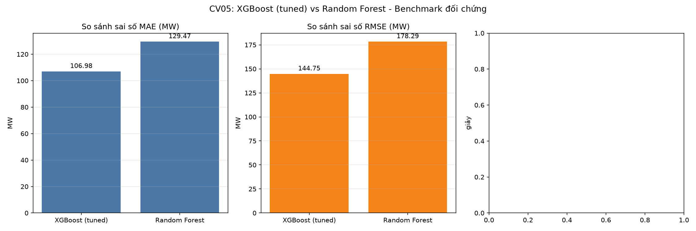

# BÁO CÁO LAB2 - NHÓM 7**Người phụ trách CV06: Trần Thị Thanh Phương**## 1. Giới thiệu Đề tài sử dụng mô hình XGBoost để dự báo dữ liệu chuỗi thời gian, đánh giá sai số và so sánh các phương pháp dự báo.\n## 2. Dữ liệu và tiền xử lý (CV01) Dữ liệu được xử lý, chia tập huấn luyện và kiểm tra trước khi xây dựng mô hình. ## 3. Huấn luyện mô hình XGBoost (CV02) Mô hình XGBoost được huấn luyện dựa trên các đặc trưng thời gian và độ trễ. ## 4. Đánh giá mô hình (CV03) Các chỉ số đánh giá gồm MAE, RMSE và MAPE. ## 5. Dự báo đa bước và Rolling Features (CV04) Phân tích tác động của đặc trưng rolling và các chiến lược dự báo đa bước.## 6. Tối ưu mô hình và đối sánh (CV05) So sánh kết quả tinh chỉnh mô hình và các phương pháp đối chứng.## 7. Tổng hợp kết quả (CV06) Các bảng và biểu đồ sau được lấy từ kết quả thực tế của nhóm.### cv01_data_summary.csv
| Chỉ số                              | Giá trị             |
|:------------------------------------|:--------------------|
| Tên tệp dữ liệu gốc                 | AEP_hourly.csv      |
| Mốc thời gian bắt đầu               | 2004-10-01 01:00:00 |
| Mốc thời gian kết thúc              | 2018-08-03 00:00:00 |
| Tổng số quan sát thô                | 121,273             |
| Số bản ghi trùng lặp (DST)          | 4                   |
| Số quan sát sau làm sạch            | 121,269             |
| Số lượng giá trị khuyết thiếu (NaN) | 0                   |
| Mức tiêu thụ trung bình (Mean MW)   | 15499.65            |
| Độ lệch chuẩn (Std MW)              | 2591.32             |
| Mức tiêu thụ nhỏ nhất (Min MW)      | 9581.00             |
| Phân vị 25% (Q1 MW)                 | 13630.00            |
| Trung vị 50% (Median MW)            | 15310.00            |
| Phân vị 75% (Q3 MW)                 | 17200.00            |
| Mức tiêu thụ lớn nhất (Max MW)      | 25695.00            |\n\n### cv02_train_history.csv\n|   iteration |   train_rmse |   test_rmse |
|------------:|-------------:|------------:|
|           0 |      2565.27 |     2609.53 |
|           1 |      2540.63 |     2584.75 |
|           2 |      2516.23 |     2560.21 |
|           3 |      2492.09 |     2535.92 |
|           4 |      2468.19 |     2511.88 |
|           5 |      2444.55 |     2488.21 |
|           6 |      2421.15 |     2464.65 |
|           7 |      2397.99 |     2441.47 |
|           8 |      2375.07 |     2418.38 |
|           9 |      2352.37 |     2395.56 |
|          10 |      2329.91 |     2372.92 |
|          11 |      2307.67 |     2350.54 |
|          12 |      2285.66 |     2328.35 |
|          13 |      2263.87 |     2306.43 |
|          14 |      2242.3  |     2284.7  |
|          15 |      2220.97 |     2263.25 |
|          16 |      2199.86 |     2241.97 |
|          17 |      2178.95 |     2220.91 |
|          18 |      2158.28 |     2200.19 |
|          19 |      2137.8  |     2179.65 |### cv03_evaluation_metrics.csv\n| metric   |      value | unit   |
|:---------|-----------:|:-------|
| MAE      | 161.616    | MW     |
| RMSE     | 211.923    | MW     |
| MAPE     |   1.11347  | %      |
| R2       |   0.992489 | score  |### cv03_feature_importance.csv|   rank | feature    |   importance | feature_type   |
|-------:|:-----------|-------------:|:---------------|
|      1 | lag_1      |  0.918705    | lag            |
|      2 | lag_3      |  0.0152096   | lag            |
|      3 | hour       |  0.0146509   | calendar       |
|      4 | lag_24     |  0.0139332   | lag            |
|      5 | lag_2      |  0.0112615   | lag            |
|      6 | lag_168    |  0.00979869  | lag            |
|      7 | dayofweek  |  0.00545694  | calendar       |
|      8 | month      |  0.0038481   | calendar       |
|      9 | dayofyear  |  0.0027568   | calendar       |
|     10 | quarter    |  0.00222709  | calendar       |
|     11 | lag_48     |  0.00146326  | lag            |
|     12 | year       |  0.000688889 | calendar       |
|     13 | is_weekend |  0           | calendar       |### cv04_multistep_metrics.csv|   horizon |   n_origins |     MAE |     RMSE |   cumulative_MAE |   cumulative_RMSE |
|----------:|------------:|--------:|---------:|-----------------:|------------------:|
|         1 |        1006 | 135.622 |  173.149 |          135.622 |           173.149 |
|         2 |        1006 | 291.876 |  372.704 |          213.749 |           290.593 |
|         3 |        1006 | 412.434 |  525.656 |          279.977 |           385.229 |
|         4 |        1006 | 464.669 |  602.516 |          326.15  |           449.508 |
|         5 |        1006 | 498.299 |  648.625 |          360.58  |           495.771 |
|         6 |        1006 | 545.507 |  701.228 |          391.401 |           535.516 |
|         7 |        1006 | 566.917 |  731.708 |          416.475 |           567.71  |
|         8 |        1006 | 565.424 |  745.298 |          435.094 |           592.825 |
|         9 |        1006 | 572.638 |  770.087 |          450.376 |           615.049 |
|        10 |        1006 | 595.915 |  813.415 |          464.93  |           637.668 |
|        11 |        1006 | 624.238 |  859.909 |          479.413 |           660.967 |
|        12 |        1006 | 645.679 |  897.746 |          493.268 |           683.837 |
|        13 |        1006 | 660.597 |  928.381 |          506.14  |           705.663 |
|        14 |        1006 | 678.952 |  961.712 |          518.483 |           726.95  |
|        15 |        1006 | 741.846 | 1039.74  |          533.374 |           751.862 |
|        16 |        1006 | 758.144 | 1059.7   |          547.422 |           774.694 |
|        17 |        1006 | 725.927 |  985.332 |          557.923 |           788.643 |
|        18 |        1006 | 691.313 |  913.664 |          565.333 |           796.104 |
|        19 |        1006 | 676.192 |  884.405 |          571.168 |           800.994 |
|        20 |        1006 | 699.409 |  907.753 |          577.58  |           806.668 |### cv05_benchmark_summary.csv\n| Model           |   MAE (MW) |   RMSE (MW) |   MAPE (%) |   R2 Score |   Train Time (s) |   Inference (ms) |   Train MAE (MW) |   Overfit Gap MAE (MW) |
|:----------------|-----------:|------------:|-----------:|-----------:|-----------------:|-----------------:|-----------------:|-----------------------:|
| XGBoost (tuned) |    106.984 |     144.752 |   0.736231 |   0.996496 |          6.67694 |          88.2471 |          79.9184 |                27.0656 |
| Random Forest   |    129.47  |     178.288 |   0.890403 |   0.994684 |         39.8805  |         694.645  |          45.6129 |                83.8576 |\n\n### cv05_best_hyperparameters.csv| hyperparameter   | best_value                                                                            |
|:-----------------|:--------------------------------------------------------------------------------------|
| learning_rate    | 0.1                                                                                   |
| max_depth        | 7                                                                                     |
| n_estimators     | 500                                                                                   |
| subsample        | 0.8                                                                                   |
| _search_meta     | GridSearchCV(TimeSeriesSplit n_splits=5); best_CV_MAE_MW=120.4892; search_time_s=85.6 |\n\n## 8. Biểu đồ minh họa\n\n\n\n\n\n\n\n\n\n\n\n\n\n\n\n## 9. Câu hỏi lý luận\n\n### Câu 1. Vì sao chọn XGBoost thay vì hồi quy tuyến tính?\nXGBoost có khả năng học các quan hệ phi tuyến và tương tác giữa nhiều đặc trưng.\nHồi quy tuyến tính đơn giản hơn nhưng có thể không mô tả đầy đủ các quan hệ phức tạp.\n\n### Câu 2. Số lượng lag ảnh hưởng thế nào đến mô hình?\nLag giúp mô hình sử dụng thông tin từ các thời điểm trước.\nQuá ít lag có thể bỏ sót thông tin; quá nhiều lag có thể tăng độ phức tạp và nguy cơ quá khớp.\n\n### Câu 3. XGBoost khác ARIMA/SARIMA như thế nào?\nARIMA/SARIMA mô hình hóa cấu trúc tự tương quan và mùa vụ của chuỗi thời gian.\nXGBoost là mô hình học máy, sử dụng các đặc trưng được thiết kế từ dữ liệu.\n\n## 10. Kết luận\nNhóm đã xây dựng quy trình dự báo chuỗi thời gian, đánh giá mô hình,\nthực hiện các thử nghiệm mở rộng và tổng hợp kết quả.\nViệc lựa chọn mô hình tốt nhất cần dựa trên kết quả kiểm tra thực tế.\n
