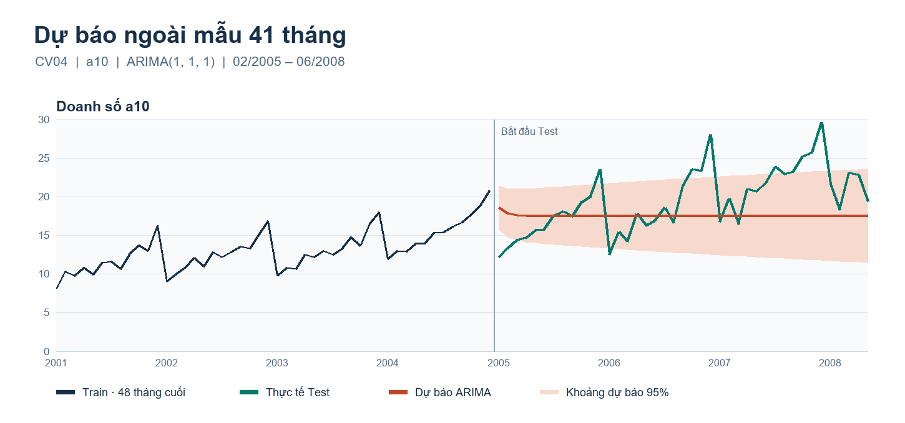
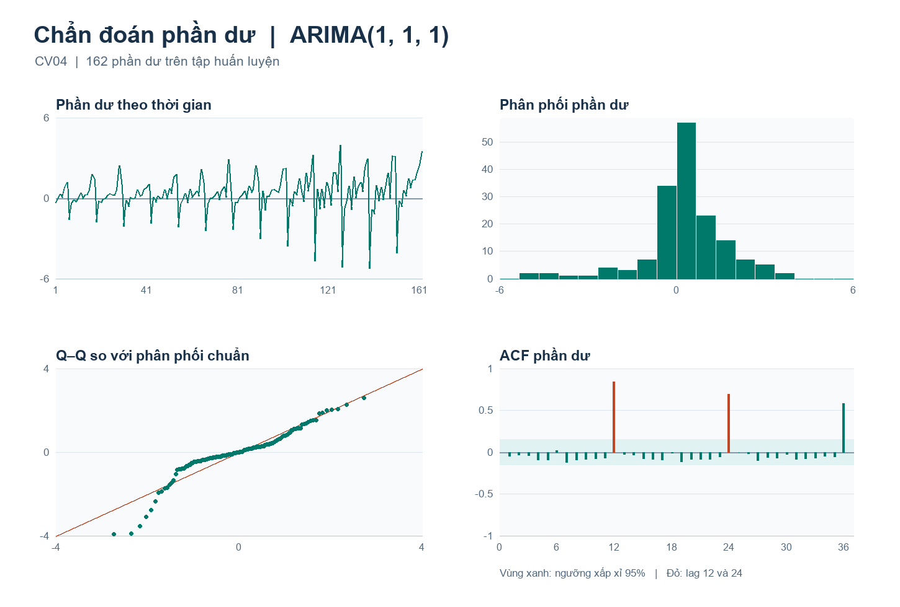

# CV04 — ARIMA trên doanh số bán lẻ a10

**Phụ trách: Hoàng · Nhóm 7 · Lab 2**

## Dữ liệu và cách chạy

- **Train:** 07/1991–01/2005, 163 tháng. **Test:** 02/2005–06/2008, 41 tháng. Các mốc đã được đối chiếu với các tệp CV01 trên nhánh `main`.
- Script đọc `outputs/tables/cv03_candidate_orders.csv` nếu có và lấy tối đa hai ứng viên theo thứ tự trong bảng. Thực nghiệm bàn giao dùng ARIMA(1,1,1) và ARIMA(2,1,1) từ ví dụ trong đề vì bảng CV03 chưa có trên nhánh.
- Mô hình được chọn theo AIC thấp nhất trong các ứng viên hội tụ trên tập Train, dùng BIC khi AIC bằng nhau. Đường dự báo được tính tại mốc 01/2005 cho đủ 41 tháng, sau đó đối chiếu với Test.
- Các bảng và hình dưới đây được tính độc lập bằng cực đại hóa likelihood Gaussian của ARMA trên sai phân bậc một trong NumPy. Môi trường bàn giao thiếu SciPy và Matplotlib để xác minh lần chạy `statsmodels`. Thời gian huấn luyện trong CSV đo lần chạy NumPy và chỉ phục vụ tham chiếu. Chạy lệnh dưới đây để xuất tệp mô hình `arima_model.pkl` và đo lại thời gian bằng cùng môi trường với CV05.

Từ thư mục gốc của repository:

```bash
python -m pip install "numpy>=1.26" "pandas>=2.1" "matplotlib>=3.8" "statsmodels==0.14.6"
python time-series-lab2/src/cv04_arima_model.py
```

Có thể chạy tương tác bằng [notebook CV04](../notebooks/cv04_hoang_arima_model.ipynb).

## Kết quả thực nghiệm

| Ứng viên | Hội tụ | AIC | BIC |
| --- | --- | ---: | ---: |
| **ARIMA(1,1,1)** | Có | **582,467** | **591,730** |
| ARIMA(2,1,1) | Có | 584,460 | 596,810 |

| MAE | RMSE | MAPE | Số tháng Test |
| ---: | ---: | ---: | ---: |
| 3,667 | 4,624 | 18,04% | 41 |

Phần dư trung bình là **0,298** trên 162 điểm sau khi bỏ mốc khởi tạo. Ljung–Box đã hiệu chỉnh bậc tự do theo `p + q`. Giá trị p là **0,269** ở lag 10, **3,06 × 10⁻²⁴** ở lag 12 và **1,52 × 10⁻³⁸** ở lag 24. Kiểm định bác bỏ giả thuyết không tự tương quan ở hai độ trễ mùa vụ. Sai số tuyệt đối lớn nhất là **12,127** vào 01/2008, khi thực tế đạt **29,665** và dự báo là **17,539**.





## Bài 5 — Câu hỏi 1–5

1. **Vì sao giữ thứ tự khi chia Train/Test?** Các quan sát gần nhau có liên hệ theo thời gian. Xáo trộn có thể đưa dữ liệu muộn vào huấn luyện để dự báo một mốc sớm hơn. Tập Test giữ 41 tháng cuối để đo sai số ngoài mẫu tại thời điểm mô hình đã được chọn.
2. **Ý nghĩa của p, d, q?** Trong ARIMA(1,1,1), `d=1` chuyển mức doanh số thành chênh lệch so với tháng trước. `p=1` dùng chênh lệch của một tháng trước và `q=1` đưa sai số dự báo của một tháng trước vào phương trình.
3. **Huấn luyện có hội tụ không?** Cả hai ứng viên hội tụ trong phép tính độc lập. ARIMA(1,1,1) được chọn vì AIC và BIC đều thấp hơn. Hội tụ xác nhận bộ tối ưu tìm được nghiệm theo tiêu chuẩn dừng. Kiểm định phần dư đánh giá mức độ phù hợp riêng.
4. **Phần dư có phải nhiễu trắng không?** Kết quả bác bỏ giả thuyết không có tự tương quan ở lag 12 và 24 tại mức 5%. ACF vẫn có gai tại các bội số của 12. Vì vậy ARIMA(1,1,1) còn bỏ sót mùa vụ và được dùng làm đường cơ sở cho CV05.
5. **Điều chỉnh gì nếu phần dư còn tương quan?** Nếu các gai tập trung ở lag ngắn, xem lại `p` và `q` dựa trên tập Train. Với gai lặp ở 12 và 24 như ở đây, thử SARIMA với chu kỳ 12, đánh giá sai phân mùa vụ và các bậc `P,Q`, rồi kiểm tra lại phần dư và so sánh dự báo trên cùng 41 tháng.

## Tệp bàn giao cho CV05

- [Chỉ số ARIMA](../outputs/tables/cv04_arima_metrics.csv)
- [So sánh hai ứng viên](../outputs/tables/cv04_arima_candidate_comparison.csv)
- [Kiểm định phần dư](../outputs/tables/cv04_residual_stats.csv)
- [Dự báo 41 tháng và khoảng dự báo 95%](../outputs/tables/cv04_arima_forecasts.csv)
