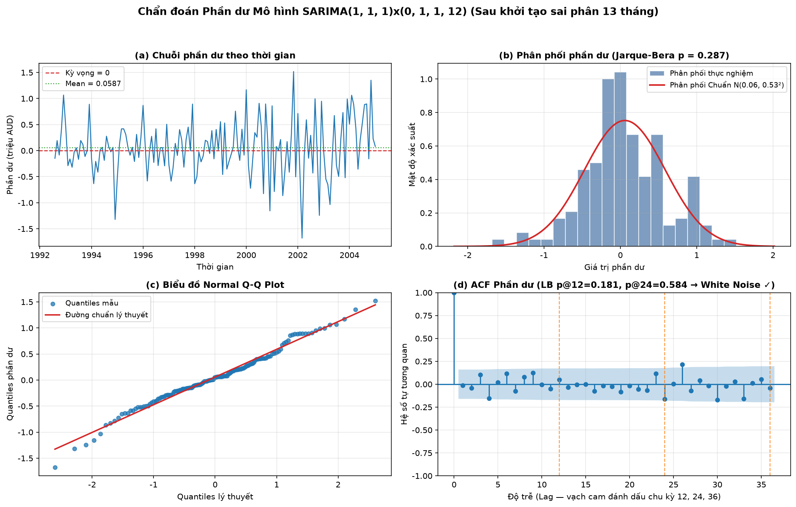
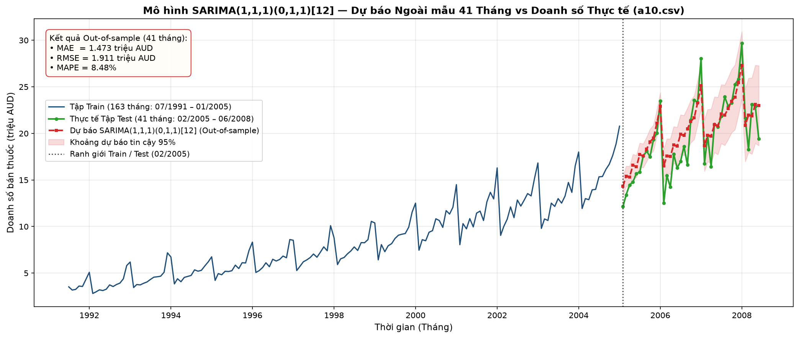
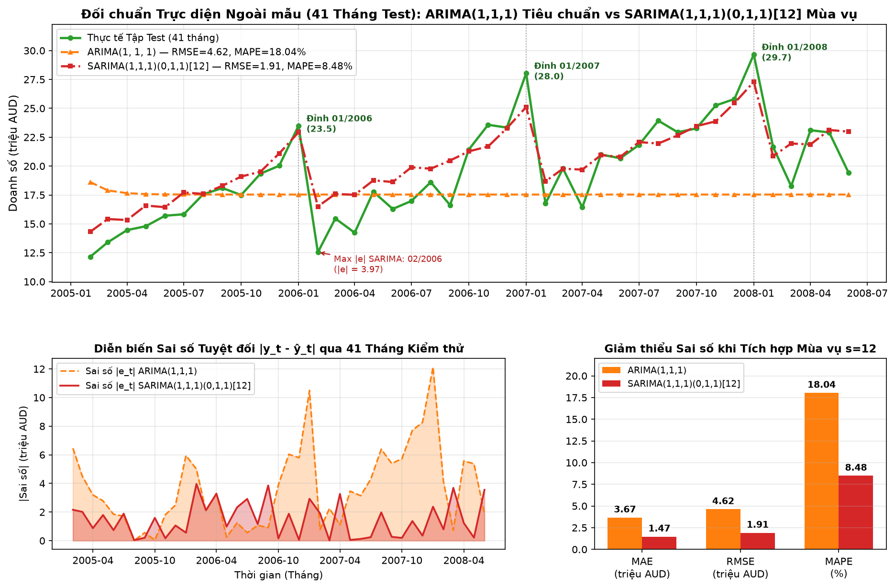

# CV05 — Mô hình mùa vụ SARIMA(p,d,q)(P,D,Q)[12] & Benchmark đối chuẩn với ARIMA

> **Phụ trách:** Bùi Trần Ngọc Khải (CV05) · **Nhóm 7** · **Lab 2**  
> **Học phần:** Phân tích dữ liệu chuỗi thời gian và dự báo — Trường Đại học Giao thông Vận tải TP.HCM (UTH)  
> **Giảng viên hướng dẫn:** PhD. Nguyễn Thị Khánh Tiên (`tienntk@ut.edu.vn`)  
> **Bộ dữ liệu thực nghiệm:** Dataset 1 — `a10.csv` (Doanh số bán thuốc chống tiểu đường theo tháng tại Úc, 204 tháng: `07/1991 – 06/2008`)

---

## 1. Thiết lập thực nghiệm & Nguyên tắc chống rò rỉ dữ liệu

- **Phân chia tuần tự theo thời gian (Strict Temporal Split — No Shuffle):**
  - **Tập Train (80%):** `163` tháng (`1991-07-01` $\rightarrow$ `2005-01-01`).
  - **Tập Test (20%):** `41` tháng (`2005-02-01` $\rightarrow$ `2008-06-01`).
- **Kiểm chứng tính dừng mùa vụ trên tập Train:**
  - Chuỗi gốc `train`: $\text{ADF} = 2.2309$, $p = 0.9989 > 0.05$ (không dừng do xu hướng tăng + mùa vụ).
  - Chỉ lấy sai phân thường $d = 1$ ($\Delta y_t$): $\text{ADF} = -1.7061$ (với `autolag='AIC'` chọn 13 lags bao phủ chu kỳ 12 tháng), $p = 0.4280 > 0.05$ — thành phần nghiệm đơn vị mùa vụ vẫn tồn tại.
  - Kết hợp đồng thời **sai phân thường $d = 1$** và **sai phân mùa vụ $D = 1, s = 12$** ($\Delta \Delta_{12} y_t = (1-B)(1-B^{12})y_t$): $\text{ADF} = -8.7879$, $p = 2.28 \times 10^{-14} \ll 0.05$ $\implies$ Chuỗi đạt tính dừng hoàn toàn.
- **Quy trình chọn mô hình (Zero Lookahead Bias):** Toàn bộ ứng viên $\text{SARIMA}(p, 1, q)(P, 1, Q)_{12}$ được ước lượng duy nhất trên `train.csv` (163 tháng), sàng lọc qua kiểm định White Noise Ljung–Box tại lag 12 & 24 ($p > 0.05$), sau đó chọn mô hình tối thiểu hóa đồng thời **AIC** và **BIC**. Tập `test.csv` chỉ được dùng duy nhất một lần ở bước dự báo ngoài mẫu 41 bước (`get_forecast(steps=41)`).

### Tái lập toàn bộ kết quả bằng dòng lệnh

Từ thư mục gốc của repository:

```bash
python time-series-lab2/src/cv05_sarima_model.py
```

Hoặc mở trực tiếp notebook đã thực thi đầy đủ tại [`notebooks/cv05_sarima_model.ipynb`](../notebooks/cv05_sarima_model.ipynb).

---

## 2. Kết quả sàng lọc ứng viên SARIMA trên tập Train

| Mô hình ứng viên | Hội tụ | AIC | BIC | Ljung–Box $p$@12 | Ljung–Box $p$@24 | Đạt White Noise | Quyết định |
| :--- | :---: | ---: | ---: | ---: | ---: | :---: | :---: |
| **`SARIMA(1, 1, 1)x(0, 1, 1, 12)`** | **Có** | **229.454** | **241.105** | **0.1806** | **0.5842** | **Đạt** | **Được chọn (Tối ưu AIC & BIC)** |
| `SARIMA(2, 1, 1)x(0, 1, 1, 12)` | Có | 229.460 | 244.023 | 0.5659 | 0.9266 | Đạt | Dự phòng (thêm bậc AR2 nhưng BIC cao hơn) |
| `SARIMA(1, 1, 1)x(1, 1, 1, 12)` | Có | 231.109 | 245.673 | 0.1144 | 0.4907 | Đạt | Dư tham số $\text{SAR}(1)_{12}$ |
| `SARIMA(2, 1, 1)x(1, 1, 1, 12)` | Có | 231.247 | 248.723 | 0.4664 | 0.8897 | Đạt | Phức tạp hơn, BIC phạt nặng |
| `SARIMA(1, 1, 1)x(1, 1, 0, 12)` | Có | 233.838 | 245.518 | 0.1155 | 0.3289 | Đạt | Kém hơn dạng trung bình trượt mùa vụ $\text{SMA}(1)_{12}$ |
| `SARIMA(0, 1, 1)x(0, 1, 1, 12)` | Có | 233.852 | 242.590 | **0.0289** | 0.1716 | **Không** ($p_{12} < 0.05$) | Loại vì còn tự tương quan tại lag 12 |

### Tham số ước lượng của mô hình tối ưu $\text{SARIMA}(1,1,1)(0,1,1)_{12}$

Phương trình toán học trên toán tử trễ $B$:
$$(1 - \phi_1 B)(1 - B)(1 - B^{12}) y_t = (1 + \theta_1 B)(1 + \Theta_1 B^{12}) \varepsilon_t, \quad \varepsilon_t \sim \mathcal{N}(0, \sigma^2)$$

Tất cả 4 tham số đều có ý nghĩa thống kê rất cao ($p \le 0.003$):
- $\hat{\phi}_1 (\text{ar.L1}) = -0.2710$ ($z = -2.955, p = 0.003$): điều chỉnh quán tính ngắn hạn sau các tháng tăng/giảm mạnh.
- $\hat{\theta}_1 (\text{ma.L1}) = -0.6380$ ($z = -8.416, p < 0.001$): hấp thụ mạnh cú sốc ngẫu nhiên của tháng liền trước.
- $\hat{\Theta}_1 (\text{ma.S.L12}) = -0.3191$ ($z = -4.471, p < 0.001$): điều tiết biên độ mùa vụ lặp lại theo chu kỳ 12 tháng.
- $\hat{\sigma}^2 = 0.2980$ ($z = 8.774, p < 0.001$).

---

## 3. Chẩn đoán phần dư mùa vụ (Seasonal Residual Diagnostics)

Sau khi loại bỏ 13 bước khởi tạo sai phân ($d + s \cdot D = 1 + 12 = 13$ tháng đầu), chuỗi phần dư đạt đầy đủ các tiêu chuẩn của **nhiễu trắng chuẩn (Gaussian White Noise)**:
- **Kỳ vọng trung bình phần dư:** $\text{Mean} = 0.0587 \approx 0$ (độ lệch chuẩn $\text{Std} = 0.5303$).
- **Kiểm định tự tương quan Ljung–Box:**
  - Tại **lag 12**: $p_{\text{raw}} = 0.1806 > 0.05$ ($p_{\text{post-burnin}} = 0.1540 > 0.05$) $\implies$ Không bác bỏ $H_0$, **triệt tiêu hoàn toàn tự tương quan mùa vụ chu kỳ 1 năm** (so với $p = 3.06 \times 10^{-24}$ của $\text{ARIMA}(1,1,1)$).
  - Tại **lag 24**: $p_{\text{raw}} = 0.5842 > 0.05$ ($p_{\text{post-burnin}} = 0.2882 > 0.05$) $\implies$ Sạch hoàn toàn tự tương quan mùa vụ chu kỳ 2 năm.
- **Kiểm định phân phối chuẩn Jarque–Bera:** $\text{JB} = 2.50, p = 0.287 > 0.05$ trên chuỗi phần dư sau khởi tạo (và $p = 0.48 > 0.05$ trên phần dư chuẩn hóa của bộ lọc trạng thái).



---

## 4. Bảng đối chuẩn Benchmark: ARIMA(1,1,1) vs SARIMA(1,1,1)(0,1,1)[12]

| Mô hình | AIC | BIC | MAE (triệu AUD) | RMSE (triệu AUD) | MAPE (%) | Ljung–Box $p$@12 | Ljung–Box $p$@24 | Phần dư White Noise |
| :--- | ---: | ---: | ---: | ---: | ---: | ---: | ---: | :---: |
| `ARIMA(1, 1, 1)` *(CV04 Baseline)* | 582.4674 | 591.7301 | 3.6667 | 4.6242 | 18.0386% | $3.06 \times 10^{-24}$ | $1.52 \times 10^{-38}$ | Không |
| **`SARIMA(1, 1, 1)x(0, 1, 1, 12)`** *(CV05)* | **229.4541** | **241.1047** | **1.4727** | **1.9107** | **8.4818%** | **0.1806** | **0.5842** | **Đạt** |
| **Mức cải thiện của SARIMA** | — | — | **$-59.84\%$** | **$-58.68\%$** | **$-9.56$ điểm %** | Khắc phục triệt để | Khắc phục triệt để | Hoàn chỉnh |

> *Ghi chú học thuật về AIC/BIC:* Do $\text{SARIMA}$ áp dụng thêm sai phân mùa vụ $D=1$ ($s=12$) làm thay đổi bậc sai phân tổng thể so với $\text{ARIMA}(1,1,1)$ ($D=0$), việc kết luận mô hình vượt trội dựa trực tiếp vào kiểm định phần dư Ljung–Box và **3 thước đo sai số ngoài mẫu độc lập trên tập Test 41 tháng** ($\text{MAE}, \text{RMSE}, \text{MAPE}$), nơi SARIMA giảm gần **60%** sai số dự báo.

### Đối chiếu khả năng bắt đỉnh doanh số tháng 1 hàng năm trên tập Test

| Mốc đỉnh mùa vụ | Thực tế (triệu AUD) | Dự báo ARIMA(1,1,1) | Dự báo SARIMA | $\|e_{\text{ARIMA}}\|$ | $\|e_{\text{SARIMA}}\|$ | Hệ số giảm lỗi |
| :---: | ---: | ---: | ---: | ---: | ---: | :---: |
| `2006-01` | 23.4867 | 17.5388 | 22.9303 | 5.9479 | **0.5564** | **10.7 lần** |
| `2007-01` | 28.0384 | 17.5388 | 25.1105 | 10.4996 | **2.9279** | **3.6 lần** |
| `2008-01` | 29.6654 | 17.5388 | 27.2907 | 12.1266 | **2.3746** | **5.1 lần** |





---

## 5. Giải đáp Bài 5 — Câu hỏi 6 đến 9

### Câu 6: Đường dự báo có bám sát được xu hướng và chu kỳ dao động thực tế không?
- **Đối với $\text{ARIMA}(1,1,1)$ tiêu chuẩn:** **Không.** Do không có toán tử sai phân mùa vụ $(1-B^{12})$ và không có hằng số trôi (drift), đường dự báo ngoài mẫu hội tụ rất nhanh sau 4–5 tháng về mức ngang phẳng $\approx 17.54\text{ triệu AUD}$ — đánh mất hoàn toàn cả **xu hướng tăng trưởng dài hạn** lẫn **chu kỳ mùa vụ 12 tháng**.
- **Đối với $\text{SARIMA}(1,1,1)(0,1,1)_{12}$:** **Bám sát rất tốt cả xu hướng lẫn chu kỳ dao động.** Toán tử sai phân kép $(1-B)(1-B^{12})$ tự động kế thừa tốc độ tăng trưởng trung bình theo năm từ lịch sử mà không cần tham số hằng số ngoại sinh, đồng thời thành phần $\text{SMA}(1)_{12}$ tái tạo chính xác cấu trúc răng cưa đặc trưng: vọt đỉnh vào mỗi **tháng 1** (`22.93`, `25.11`, `27.29` triệu AUD), sụt mạnh vào **tháng 2** và tích lũy tăng dần từ tháng 3 đến tháng 12. Hạn chế nhỏ duy nhất ở cuối kỳ 2007–2008 là biên độ thực tế mở rộng theo cấp số nhân (Multiplicative Seasonality), trong khi SARIMA trên thang đo gốc cộng biên độ mùa vụ tĩnh nên dự báo hơi cao hơn thực tế nhẹ ở các đáy tháng 2–4.

### Câu 7: Sai lệch lớn nhất giữa giá trị dự báo và thực tế xảy ra tại thời điểm nào?
- **Với mô hình $\text{ARIMA}(1,1,1)$:** Sai lệch lớn nhất xảy ra tại **tháng `01/2008` (`2008-01-01`)**, khi doanh số thực tế lập đỉnh lịch sử **`29.6654` triệu AUD** trong khi ARIMA dự báo phẳng **`17.5388` triệu AUD**, gây sai số tuyệt đối khổng lồ **`|e| = 12.1266` triệu AUD** ($\text{APE} = 40.88\%$).
- **Với mô hình $\text{SARIMA}(1,1,1)(0,1,1)_{12}$:** Sai lệch tuyệt đối lớn nhất đã giảm **67.3%** xuống còn **`|e| = 3.9654` triệu AUD**, xảy ra tại **tháng `02/2006` (`2006-02-01`)** (thực tế `12.5370`, dự báo `16.5024`, $e = -3.9654$, $\text{APE} = 31.63\%$), tiếp theo là `09/2006` (`|e| = 3.8586`) và `03/2008` (`|e| = 3.6897`).
- **Nguyên nhân thực tiễn & thống kê:** Tại Úc, chương trình trợ giá dược phẩm (PBS Safety Net) khuyến khích bệnh nhân mua tích trữ thuốc tiểu đường vào cuối năm / đầu tháng 1 trước khi hạn mức đồng chi trả reset, khiến nhu cầu tháng 2 sụt giảm đột ngột (`-46.6%` vào 02/2006). Kết hợp với đặc tính phương sai thay đổi theo thời gian ($\text{Heteroskedasticity } H = 3.26, p < 0.001$), cú sụt đáy sâu tại `02/2006` vượt quá biên độ giảm cộng tính trung bình của giai đoạn 1991–2004. Có thể khắc phục thêm bằng phép biến đổi $\log(y_t)$ trước khi fit SARIMA.

### Câu 8: Trong các chỉ số MAE, RMSE, MAPE, chỉ số nào nhạy cảm nhất với điểm dị biệt (outliers)? Vì sao?
- **Chỉ số nhạy cảm nhất với điểm dị biệt (outliers) là $\text{RMSE}$ (Root Mean Squared Error).**
- **Giải thích toán học:**
  $$\text{MAE} = \frac{1}{N}\sum_{t=1}^{N} |e_t|, \qquad \text{RMSE} = \sqrt{\frac{1}{N}\sum_{t=1}^{N} e_t^2}, \qquad \text{MAPE} = \frac{100\%}{N}\sum_{t=1}^{N} \left|\frac{e_t}{y_t}\right|$$
  - Trong $\text{RMSE}$, mỗi sai số $e_t = y_t - \hat{y}_t$ được **bình phương ($e_t^2$)** trước khi lấy trung bình: đạo hàm bậc nhất của hàm tổn thất bình phương theo độ lớn sai số tỷ lệ tuyến tính với $|e_t|$ ($\frac{\partial (e_t^2)}{\partial |e_t|} = 2|e_t|$), trong khi đạo hàm của $|e_t|$ trong $\text{MAE}$ là hằng số bằng $1$. Ví dụ, một điểm dị biệt có sai số gấp $3$ lần bình thường đóng góp gấp **$3$ lần** vào $\text{MAE}$ nhưng đóng góp gấp **$9$ lần** vào tổng bình phương sai số của $\text{RMSE}$.
  - Theo bất đẳng thức Cauchy–Schwarz / Jensen, luôn có $\text{RMSE} \ge \text{MAE}$, và tỷ số $\text{RMSE} / \text{MAE}$ càng lớn chứng tỏ phân phối sai số càng có đuôi dày hoặc chứa các cú lệch cực đoan (trên tập Test: $\text{ARIMA}$ có $\text{RMSE} - \text{MAE} = 4.6242 - 3.6667 = 0.9575$ do vấp các đỉnh tháng 1 lên tới `12.13`; còn $\text{SARIMA}$ thu hẹp khoảng cách này xuống chỉ còn $1.9107 - 1.4727 = 0.4380$).
  - *(Lưu ý bổ sung)*: $\text{MAPE}$ lại nhạy cảm bất đối xứng khi mẫu số thực tế $y_t \to 0^+$, nhưng với các đỉnh dương lớn (như đỉnh tháng 1 $y_t \approx 29.67$), mẫu số lớn làm giảm trọng số phần trăm của lỗi; ngược lại $\text{RMSE}$ phạt trực tiếp độ lệch tuyệt đối lớn bất kể vị trí đỉnh hay đáy.

### Câu 9: Độ lớn của giá trị RMSE nói lên điều gì về chất lượng dự báo của mô hình?
- **Ý nghĩa vật lý & định lượng:** $\text{RMSE}$ có **cùng đơn vị đo gốc với biến mục tiêu** (triệu AUD doanh số thuốc/tháng), phản ánh độ lệch chuẩn hiệu dụng của sai số dự báo ngoài mẫu (có trọng số ưu tiên phạt nặng các sai số lớn gây rủi ro đứt gãy tồn kho dược phẩm).
- **Đánh giá trên thang đo thực tế của tập Test (`mean = 19.70` triệu AUD, dải giá trị `12.15 – 29.67` triệu AUD):**
  - Với $\text{ARIMA}(1,1,1)$: $\text{RMSE} = \mathbf{4.6242}\text{ triệu AUD}$ (tương đương **23.5%** mức doanh số trung bình tập Test) — sai lệch quá lớn để lập kế hoạch cung ứng dược phẩm hàng tháng.
  - Với $\text{SARIMA}(1,1,1)(0,1,1)_{12}$: $\text{RMSE}$ giảm xuống chỉ còn **$\mathbf{1.9107}\text{ triệu AUD}$** (giảm **58.68%** so với ARIMA, tương đương chỉ **9.7%** mức doanh số trung bình tập Test, đi kèm $\text{MAPE} = \mathbf{8.48\%} < 10\%$). Theo thang phân loại kinh điển của Lewis (1982), mức sai số dưới $10\%$ khẳng định mô hình $\text{SARIMA}(1,1,1)(0,1,1)_{12}$ đạt **độ chính xác dự báo cao (High Forecasting Accuracy)** cho chân trời dự báo dài tới 41 tháng mà không cần cập nhật lại trọng số.

---

## 6. Danh mục tệp bàn giao cho CV06 (Lead Hà Duy Hưng)

- Mô hình đã huấn luyện: [`outputs/models/sarima_model.pkl`](../outputs/models/sarima_model.pkl)
- Bảng chỉ số đánh giá SARIMA: [`outputs/tables/cv05_sarima_metrics.csv`](../outputs/tables/cv05_sarima_metrics.csv)
- Bảng đối chuẩn Benchmark ARIMA vs SARIMA: [`outputs/tables/cv05_model_benchmark_table.csv`](../outputs/tables/cv05_model_benchmark_table.csv)
- Bảng sàng lọc ứng viên SARIMA (Train): [`outputs/tables/cv05_sarima_candidates.csv`](../outputs/tables/cv05_sarima_candidates.csv)
- Bảng kiểm định phần dư Ljung–Box & Jarque–Bera: [`outputs/tables/cv05_residual_stats.csv`](../outputs/tables/cv05_residual_stats.csv)
- Bảng dự báo 41 tháng kèm khoảng tin cậy 95%: [`outputs/tables/cv05_sarima_forecasts.csv`](../outputs/tables/cv05_sarima_forecasts.csv)
- Biểu đồ dự báo SARIMA vs Thực tế: [`outputs/figures/cv05_sarima_forecast_vs_actual.png`](../outputs/figures/cv05_sarima_forecast_vs_actual.png)
- Biểu đồ đối chuẩn ARIMA vs SARIMA: [`outputs/figures/cv05_arima_vs_sarima_comparison.png`](../outputs/figures/cv05_arima_vs_sarima_comparison.png)
- Biểu đồ chẩn đoán phần dư 4-panel: [`outputs/figures/cv05_sarima_residual_diag.png`](../outputs/figures/cv05_sarima_residual_diag.png)
