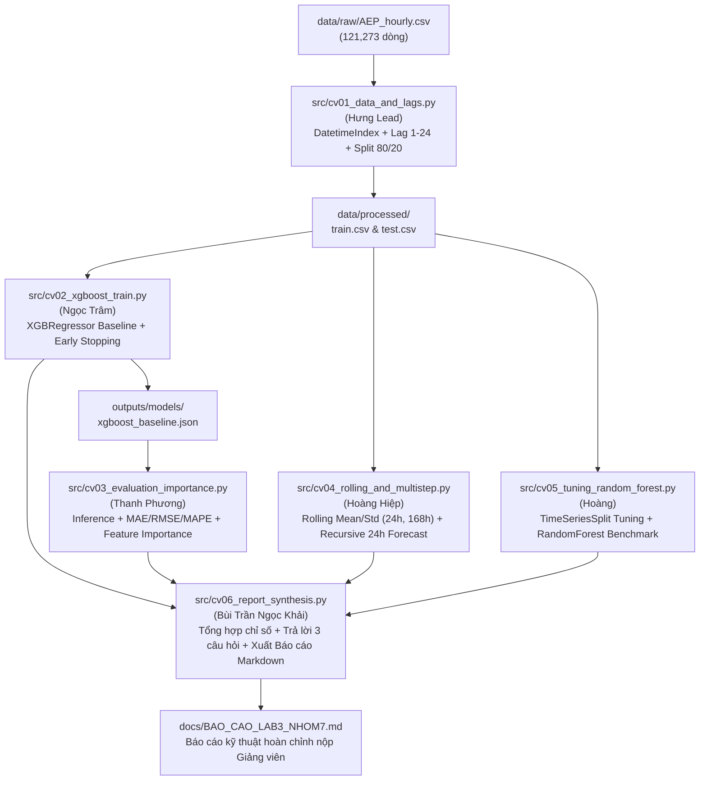

# BẢNG PHÂN CÔNG NHIỆM VỤ NHÓM 7 - LAB 3 (QLCTG)
## BÀI TẬP THỰC HÀNH 3: DỰ BÁO CHUỖI THỜI GIAN SỬ DỤNG XGBOOST REGRESSOR

> **Học phần:** Quản lý & Khai phá Chuỗi Thời gian (QLCTG) - UTH  
> **Nhóm thực hiện:** Nhóm 7 (`QLCTG_nhom7`)  
> **Nhóm trưởng:** Hà Duy Hưng  
> **Giảng viên hướng dẫn:** PhD. Nguyễn Thị Khánh Tiên (`tienntk@ut.edu.vn`)  
> **Bộ dữ liệu thực nghiệm:** [Hourly Energy Consumption (PJM) - AEP_hourly.csv](file:///e:/Chuỗi_TG/time-series-lab2/data/raw/AEP_hourly.csv) (121,273 quan sát)  
> **Kho lưu trữ GitHub:** [HADUYHUNG-0912/QLCTG_nhom7](https://github.com/HADUYHUNG-0912/QLCTG_nhom7.git)

---

### 1. MA TRẬN PHÂN CÔNG NHIỆM VỤ CHI TIẾT (6 THÀNH VIÊN)

| MÃ CV | HẠNG MỤC CÔNG VIỆC | MÔ TẢ CHI TIẾT & YÊU CẦU THỰC HIỆN | TỆP BÀN GIAO (DELIVERABLES) | PHỤ TRÁCH & NHÁNH GIT | TRẠNG THÁI |
| :---: | :--- | :--- | :--- | :---: | :---: |
| **CV01** | **Quản trị Pipeline, Tiền xử lý & Sinh Lag Features (Bước 1, 2, 3)** | • Tải chuỗi `AEP_hourly.csv` từ `data/raw/`, thiết lập `DatetimeIndex`, kiểm tra tính toàn vẹn (khuyết thiếu, trùng lặp).<br>• Biến đổi bài toán chuỗi thời gian thành học có giám sát bằng kỹ thuật tạo Lag Features ($y_{t-1}, y_{t-2}, \dots, y_{t-24}$).<br>• Xử lý triệt để các giá trị NaN phát sinh (`dropna()`).<br>• Tách ma trận đặc trưng $X$ và nhãn mục tiêu $y$.<br>• Chia tập Train/Test theo thời gian ($80\%$ Train, $20\%$ Test - tuyệt đối không shuffle) và xuất ra `data/processed/`. | • [src/cv01_data_and_lags.py](file:///e:/Chuỗi_TG/time-series-lab2/src/cv01_data_and_lags.py)<br>• `data/processed/train.csv`, `test.csv`<br>• `outputs/tables/cv01_data_summary.csv`<br>• `outputs/figures/cv01_raw_and_lags.png` | **Hà Duy Hưng (Lead)**<br>`main` | 🟡 In Progress |
| **CV02** | **Huấn luyện mô hình cơ sở XGBoost Regressor (Bước 4, 5)** | • Khởi tạo `xgboost.XGBRegressor` với các siêu tham số chuẩn mực (`n_estimators=1000`, `learning_rate=0.01`, `max_depth=5`, `early_stopping_rounds=50`).<br>• Huấn luyện mô hình và truyền `eval_set=[(X_train, y_train), (X_test, y_test)]`.<br>• Trích xuất và vẽ Learning Loss Curve (Train RMSE vs Test RMSE) qua từng vòng lặp (vòng lặp dừng sớm).<br>• Lưu trữ model checkpoint vào `outputs/models/xgboost_baseline.json`. | • [src/cv02_xgboost_train.py](file:///e:/Chuỗi_TG/time-series-lab2/src/cv02_xgboost_train.py)<br>• `outputs/models/xgboost_baseline.json`<br>• `outputs/figures/cv02_learning_curve.png`<br>• `outputs/tables/cv02_train_history.csv` | **Ngọc Trâm**<br>`feat/cv02-xgb-train` | 🟡 In Progress |
| **CV03** | **Đánh giá chỉ số định lượng & Phân tích Feature Importance (Bước 6, 7)** | • Thực hiện suy luận dự báo trên tập kiểm thử Test: $\hat{y}_{\text{test}} = \operatorname{predict}(X_{\text{test}})$.<br>• Tính toán 4 chỉ số chuẩn mực: **MAE, RMSE, MAPE (%), $R^2$ Score**.<br>• Vẽ biểu đồ đối chứng trực quan Actual vs Predicted (toàn tập test và phóng to zoom 1 tuần 168 giờ).<br>• Trích xuất `feature_importances_`, vẽ biểu đồ cột thứ hạng quan trọng của các lag features.<br>• Phân tích học thuật: Lag nào chi phối lớn nhất đến phụ tải điện? | • [src/cv03_evaluation_importance.py](file:///e:/Chuỗi_TG/time-series-lab2/src/cv03_evaluation_importance.py)<br>• `outputs/figures/cv03_actual_vs_predicted.png`<br>• `outputs/figures/cv03_feature_importance.png`<br>• `outputs/tables/cv03_evaluation_metrics.csv` | **Thanh Phương**<br>`feat/cv03-evaluation` | 🟡 In Progress |
| **CV04** | **Nâng cao 1 & 2: Rolling Features & Dự báo Đa bước (Multi-Step)** | • **Nâng cao 1:** Tạo các đặc trưng thống kê trượt `rolling_mean_24`, `rolling_std_24`, `rolling_mean_168`. Bắt buộc tính trên giá trị đã trễ `.shift(1)` để tránh rò rỉ dữ liệu.<br>• Đánh giá mức độ cải thiện của mô hình khi bổ sung rolling features.<br>• **Nâng cao 2:** Xây dựng cơ chế dự báo 24 giờ tiếp theo ($t+1 \dots t+24$) theo Chiến lược Đệ quy (Recursive Strategy) và Chiến lược Trực tiếp (Direct Strategy).<br>• Trực quan hóa sai số tích lũy qua từng bước dự báo. | • [src/cv04_rolling_and_multistep.py](file:///e:/Chuỗi_TG/time-series-lab2/src/cv04_rolling_and_multistep.py)<br>• `outputs/figures/cv04_rolling_features_impact.png`<br>• `outputs/figures/cv04_multistep_forecast.png`<br>• `outputs/tables/cv04_multistep_metrics.csv` | **Hoàng Hiệp**<br>`feat/cv04-rolling-multistep` | 🟡 In Progress |
| **CV05** | **Nâng cao 3 & 4: Tinh chỉnh Siêu tham số & So sánh Random Forest** | • **Nâng cao 3:** Cấu hình `TimeSeriesSplit` (5 folds) kết hợp `RandomizedSearchCV`/`GridSearchCV` để tìm bộ siêu tham số tối ưu (`max_depth`, `learning_rate`, `n_estimators`, `subsample`, `colsample_bytree`).<br>• **Nâng cao 4:** Huấn luyện mô hình đối chứng `RandomForestRegressor` trên cùng tập dữ liệu.<br>• Lập bảng so sánh Benchmark: Thời gian huấn luyện, tốc độ suy luận, MAE, RMSE, MAPE, mức độ Overfitting. | • [src/cv05_tuning_random_forest.py](file:///e:/Chuỗi_TG/time-series-lab2/src/cv05_tuning_random_forest.py)<br>• `outputs/figures/cv05_benchmark_comparison.png`<br>• `outputs/tables/cv05_best_hyperparameters.csv`<br>• `outputs/tables/cv05_benchmark_summary.csv` | **Hoàng**<br>`feat/cv05-tuning-benchmark` | 🟡 In Progress |
| **CV06** | **Lý luận chuyên sâu (3 câu hỏi) & Báo cáo kỹ thuật tổng hợp** | • Biên soạn lời giải chi tiết và lập luận khoa học cho 3 câu hỏi lý luận:<br>  1. So sánh XGBoost vs Linear Regression (phi tuyến tính, đa cộng tuyến, ngoại suy).<br>  2. Tác động của việc tăng số lượng độ trễ $p$ (lợi ích chu kỳ vs overfitting).<br>  3. Khi nào XGBoost vượt trội hơn ARIMA/SARIMA?<br>• Xây dựng script tích hợp toàn bộ pipeline (`cv06_report_synthesis.py`) kiểm tra tính độc lập và đồng bộ của 5 module trước.<br>• Hoàn thiện Báo cáo kỹ thuật tổng kết toàn diện `BAO_CAO_LAB3_NHOM7.md`. | • [src/cv06_report_synthesis.py](file:///e:/Chuỗi_TG/time-series-lab2/src/cv06_report_synthesis.py)<br>• [docs/BAO_CAO_LAB3_NHOM7.md](file:///e:/Chuỗi_TG/time-series-lab2/docs/BAO_CAO_LAB3_NHOM7.md)<br>• `outputs/tables/final_model_comparison.csv`<br>• `outputs/figures/cv06_summary_dashboard.png` | **Bùi Trần Ngọc Khải**<br>`feat/cv06-report-theory` | 🟡 In Progress |

---

### 2. SƠ ĐỒ LUỒNG DỮ LIỆU ĐỒNG BỘ GIỮA CÁC MODULE (PIPELINE DAG)



---

### 3. HƯỚNG DẪN DÀNH CHO THÀNH VIÊN KHI DÙNG AI AGENT (PROMPT & GUARDRAILS)

Để đảm bảo các thành viên khi sử dụng các công cụ lập trình AI (Cursor, Claude Code, GitHub Copilot, Antigravity) không làm sai lệch cấu trúc dự án và mã nguồn đồng bộ 100%, hãy copy đoạn lệnh sau vào AI Agent:

#### Mẫu System Prompt chuẩn dành cho AI Agent của từng thành viên:
> *"Tôi là [Tên thành viên] phụ trách nhiệm vụ [Mã CV] trong dự án QLCTG_nhom7 tại thư mục `time-series-lab2`. Bạn hãy mở tệp mã nguồn tương ứng tại `src/[tên_file.py]`. Đọc kỹ phần `AI_AGENT_INSTRUCTIONS` ở đầu file. Tuân thủ tuyệt đối các nguyên tắc:  
> 1. Sử dụng đúng đường dẫn tương đối từ gốc dự án (`PROJECT_ROOT`).  
> 2. Chia train/test theo thứ tự thời gian, tuyệt đối KHÔNG shuffle.  
> 3. Tính rolling features phải thông qua `.shift(1)` để tránh rò rỉ dữ liệu.  
> 4. Xuất toàn bộ biểu đồ vào `outputs/figures/` với chuẩn DPI 150, hỗ trợ tiếng Việt Unicode (`Segoe UI` / `Arial`).  
> 5. Xuất toàn bộ bảng chỉ số vào `outputs/tables/` định dạng `.csv`.  
> 6. Script phải chạy được độc lập từ command line bằng lệnh `python src/[tên_file.py]` mà không phụ thuộc file khác."*

---

### 4. QUY TRÌNH PHỐI HỢP GIT & KIỂM THỬ ĐỒNG BỘ

1. **Clone và cài đặt môi trường:**
   ```bash
   git clone https://github.com/HADUYHUNG-0912/QLCTG_nhom7.git
   cd QLCTG_nhom7/time-series-lab2
   pip install -r requirements.txt
   ```
2. **Kiểm tra dữ liệu gốc:** Đảm bảo `data/raw/AEP_hourly.csv` đã có mặt (kích thước ~3.4 MB).
3. **Thực thi tuần tự các module:**
   ```bash
   python src/cv01_data_and_lags.py
   python src/cv02_xgboost_train.py
   python src/cv03_evaluation_importance.py
   python src/cv04_rolling_and_multistep.py
   python src/cv05_tuning_random_forest.py
   python src/cv06_report_synthesis.py
   ```
4. **Quy tắc tạo nhánh (Branching Convention):**
   - Mỗi thành viên tạo nhánh riêng: `git checkout -b feat/cv0X-[ten-nhiem-vu]`.
   - Sau khi hoàn thành và kiểm thử mã lệnh trả về mã thoát 0, tạo Pull Request vào nhánh `main` để Nhóm trưởng (Hà Duy Hưng) review và merge.
