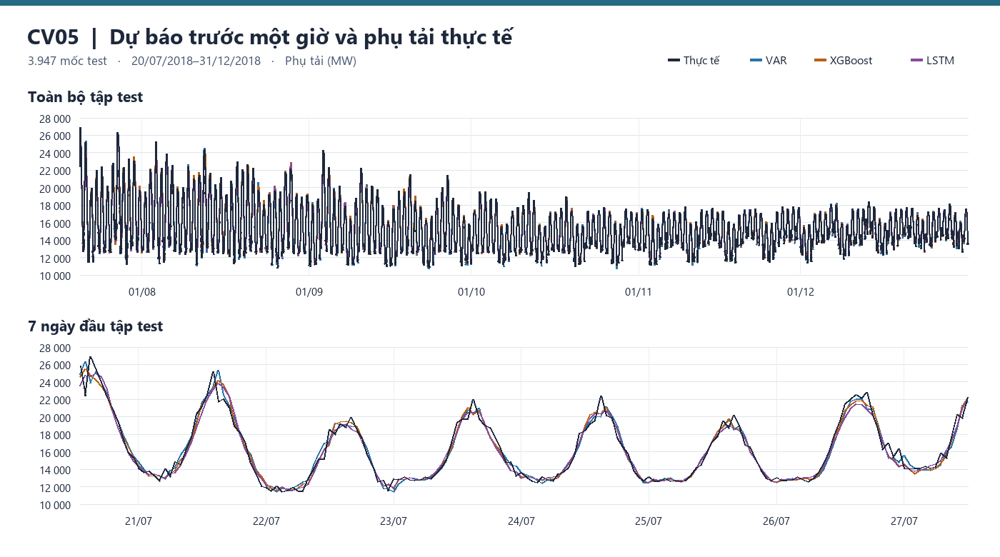

# TIME SERIES LAB 4 — NHÓM 7 (Phân tích dữ liệu chuỗi thời gian và dự báo)
## BÀI THỰC HÀNH 4: MULTIVARIATE TIME SERIES FORECASTING
### (VAR vs XGBoost vs LSTM)

> **Đơn vị đào tạo:** Khoa Công nghệ Thông tin — Trường Đại học Giao thông Vận tải TP.HCM (UTH)  
> **Giảng viên hướng dẫn:** PhD. Nguyễn Thị Khánh Tiên (`tienntk@ut.edu.vn`)  
> **Nhóm thực hiện:** Nhóm 7 (6 thành viên)  
> **Bộ dữ liệu:** Electricity Load Diagrams Dataset (UCI) + Weather Data  

---

## 1. PHÂN CÔNG THÀNH VIÊN & TIẾN ĐỘ

| Mã CV | Thành viên | Nhánh làm việc | Nhiệm vụ | Deadline | Trạng thái |
| :---: | :--- | :---: | :--- | :---: | :---: |
| **CV01** | **Hà Duy Hưng (Lead)** | `main` | EDA + Preprocessing + Lag Features | 05/11 | 🟢 **Đã hoàn thành** |
| **CV02** | **Hiệp** | `main` | Mô hình VAR (Statistical Baseline) | 08/11 | 🟢 **Đã hoàn thành** |
| **CV03** | **Phương** | `main` | Mô hình XGBoost (Machine Learning) | 08/11 | 🟢 **Đã hoàn thành** |
| **CV04** | **Châm** | `cham-lab04` | Mô hình LSTM (Deep Learning) | 12/11 | 🟢 **Đã hoàn thành** |
| **CV05** | **Hoàng** | `hoang-lab04` | Walk-forward Backtesting + So sánh | 12/11 | 🟡 **Đã kiểm chứng sai số, chờ đo thời gian** |
| **CV06** | **Khải** | `khai-lab04` | Tổng hợp báo cáo + 6 câu hỏi lý luận | 14/11 | ⏳ **Kế hoạch** |

---

## 2. CÀI ĐẶT MÔI TRƯỜNG

```bash
cd time-series-lab4
pip install -r requirements.txt
```

## 3. THỨ TỰ CHẠY

```bash
python src/cv01_eda_and_preprocessing.py
python src/cv02_var_model.py
python src/cv03_xgboost_model.py
python src/cv04_lstm_model.py
python src/cv05_backtesting_comparison.py
python src/cv06_report_synthesis.py
```

## 4. TÀI LIỆU

- [Kiến trúc Pipeline Training & Inference](docs/PIPELINE_WORKFLOW.md)
- [Đề bài đầy đủ](docs/DE_BAI_LAB.md)
- [Kế hoạch phân công](docs/KE_HOACH_PHAN_CONG_NHOM7.md)
- [Báo cáo kỹ thuật](docs/BAO_CAO_LAB4_NHOM7.md) *(CV06 sẽ tạo)*

## 5. CV05 — Walk-forward Backtesting (Hoàng)

Tại mỗi mốc, cả ba mô hình dự báo phụ tải trước một giờ từ dữ liệu quan sát tới giờ liền trước. Khi giá trị thực xuất hiện, cửa sổ trượt được cập nhật để dự báo giờ kế tiếp. Mỗi mô hình được huấn luyện trước test và giữ nguyên trọng số trong quá trình kiểm thử. VAR cộng sai phân dự báo với mức phụ tải thực của giờ liền trước. XGBoost dùng chính bộ đặc trưng của CV03 và LSTM dùng cửa sổ 24 giờ.

Trên **3.947 mốc test** từ 13:00 ngày 20/07/2018 đến 23:00 ngày 31/12/2018, LSTM có RMSE thấp nhất, thấp hơn XGBoost khoảng **1,74 MW**. Cả ba mô hình có MAE theo giờ cao nhất ở **00:00**. Bảng và hình đã đối chiếu với kết quả CV02–CV04 trên bộ benchmark phụ tải–thời tiết của nhóm.

| Mô hình | RMSE (MW) | MAE (MW) | MAPE |
| --- | ---: | ---: | ---: |
| LSTM | 475,70 | 326,96 | 2,15% |
| XGBoost | 477,45 | 328,81 | 2,16% |
| VAR | 524,13 | 361,12 | 2,39% |

- [Bảng CSV đối chuẩn](outputs/tables/cv05_final_comparison.csv) và [notebook CV05](notebooks/cv05_hoang_backtesting.ipynb).
- [Biểu đồ bốn đường](outputs/figures/cv05_actual_vs_all_models.png) đối chiếu phụ tải thực tế với ba dự báo, có phần phóng to bảy ngày đầu.
- [Heatmap](outputs/figures/cv05_error_heatmap_by_hour.png) cho thấy MAE từng mô hình theo giờ trong ngày.
- [Biểu đồ cột](outputs/figures/cv05_model_comparison_bar.png) so sánh các chỉ số giữa ba mô hình.

Bảng đã xuất để trống thời gian huấn luyện và dự báo. Chạy CV02–CV05 trên cùng môi trường để điền số đo. CV02–CV04 ghi thời gian gọi `fit()` vào bảng của từng mô hình. CV05 làm nóng mỗi mô hình rồi đo thời gian gọi dự báo từng mốc, không tính thời gian tải mô hình, chuẩn bị đặc trưng hoặc ghi tệp. Cột `InferTime(ms/step)` là độ trễ trung bình mỗi bước. MAPE bỏ qua các mốc tải bằng 0.


