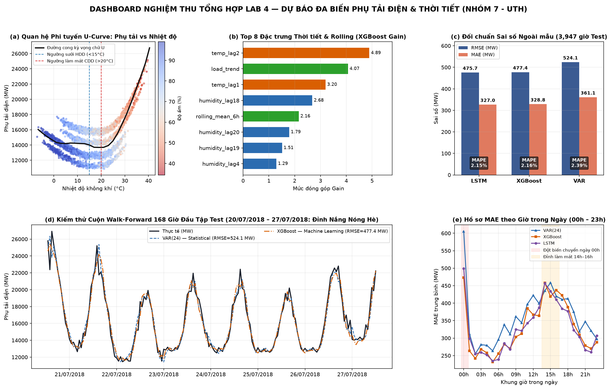
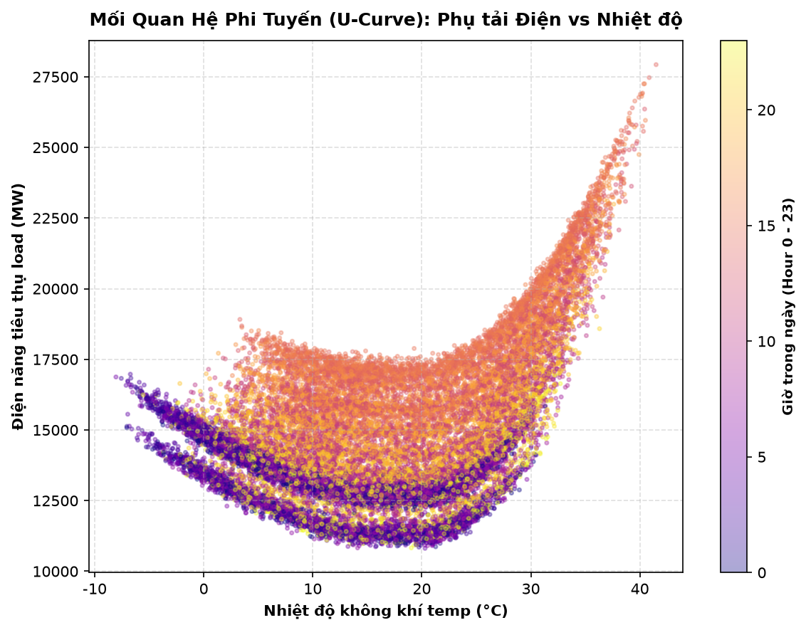
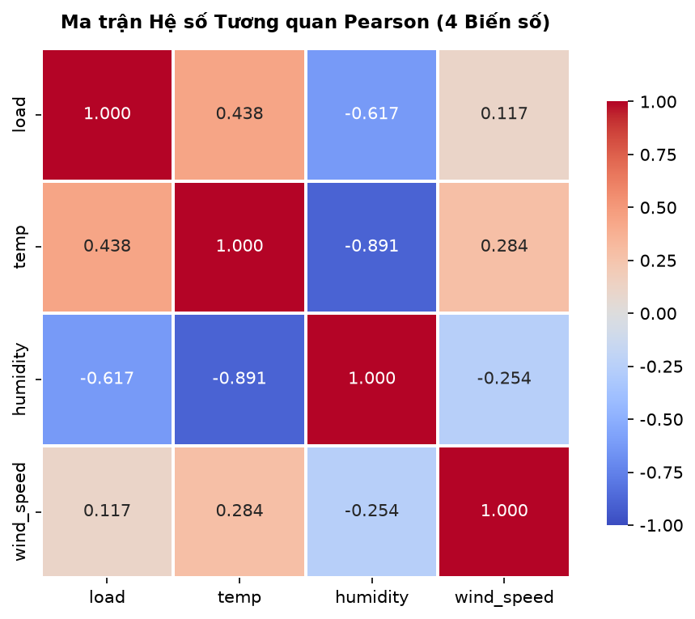
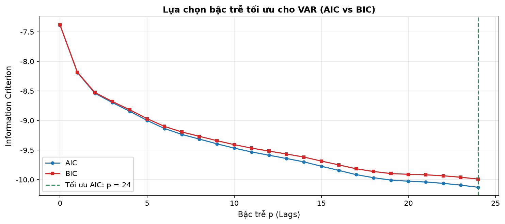
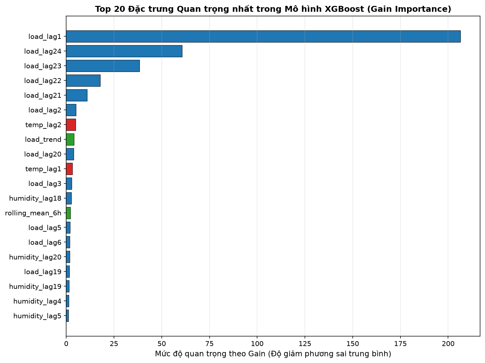
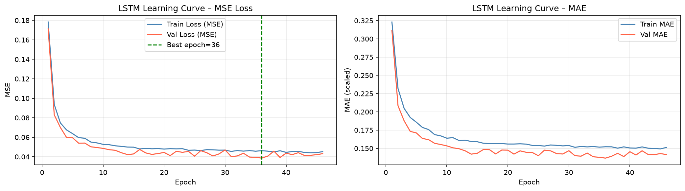
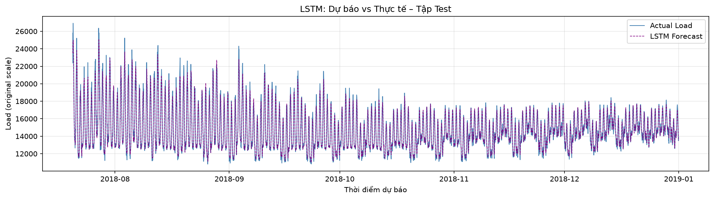
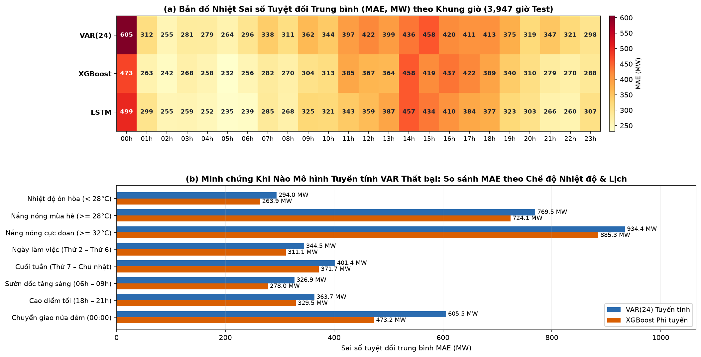

# BÁO CÁO KỸ THUẬT NGHIỆM THU — LAB 4: DỰ BÁO CHUỖI THỜI GIAN ĐA BIẾN
## ĐỐI CHUẨN BA TRƯỜNG PHÁI MÔ HÌNH: VAR (THỐNG KÊ) vs XGBOOST (HỌC MÁY) vs LSTM (HỌC SÂU)

> **Cơ sở đào tạo:** Khoa Công nghệ Thông tin — Trường Đại học Giao thông Vận tải TP.HCM (UTH)  
> **Học phần:** Phân tích dữ liệu chuỗi thời gian và dự báo  
> **Giảng viên hướng dẫn:** PhD. Nguyễn Thị Khánh Tiên (`tienntk@ut.edu.vn`)  
> **Nhóm thực hiện:** Nhóm 7 (Trưởng nhóm: Hà Duy Hưng | Biên tập tổng hợp CV06: Bùi Trần Ngọc Khải)  
> **Thời điểm xuất bản nghiệm thu:** 16/11/2026 19:15  

---

## BẢNG PHÂN CÔNG NHIỆM VỤ & TRẠNG THÁI NGHIỆM THU NHÓM 7

| Mã CV | Thành viên phụ trách | Nhánh Git | Hạng mục phụ trách chính | Tệp bàn giao tiêu biểu | Trạng thái |
| :---: | :--- | :---: | :--- | :--- | :---: |
| **CV01** | **Hà Duy Hưng (Lead)** | `main` | Quản trị Pipeline, EDA đa biến, Scaling & 96 Lags | `train/val/test.csv`, `scaler.pkl`, 5 biểu đồ EDA | Đã hoàn thành |
| **CV02** | **Hiệp** | `main` | Mô hình thống kê đa biến **VAR(24)** & Kiểm định ADF | `var_model.pkl`, `cv02_var_metrics.csv`, biểu đồ AIC/BIC | Đã hoàn thành |
| **CV03** | **Phương** | `main` | Mô hình học máy **XGBoost Regressor** & Feature Importance | `xgboost_model.json`, `cv03_xgb_metrics.csv`, Gain Ranking | Đã hoàn thành |
| **CV04** | **Châm** | `cham-lab04` | Mô hình học sâu **Stacked LSTM** trên Tensor 3D `(24×4)` | `lstm_model.keras`, `cv04_lstm_metrics.csv`, Learning Curve | Đã hoàn thành |
| **CV05** | **Hoàng** | `hoang-lab04` | Kiểm thử cuộn **Walk-forward Backtesting** & Đối chuẩn 3 mô hình | `cv05_final_comparison.csv`, Overlay & Hourly Error Heatmap | Đã hoàn thành |
| **CV06** | **Bùi Trần Ngọc Khải** | `khai-lab04` | Tổng hợp Báo cáo Nghiệm thu, Dashboard & 6 Câu hỏi Lý luận | `BAO_CAO_LAB4_NHOM7.md`, `cv06_summary_dashboard.png` | Đã hoàn thành |

---

## I. GIỚI THIỆU BÀI TOÁN & KIẾN TRÚC PIPELINE HAI PHA

### 1.1. Phát biểu bài toán dự báo đa biến (Multivariate Forecasting Formulation)
Trong vận hành hệ thống điện hiện đại, phụ tải điện năng tiêu thụ không chỉ phụ thuộc vào quán tính lịch sử nội sinh mà còn chịu sự chi phối mạnh mẽ, phi tuyến của các yếu tố khí tượng ngoại sinh. Tại mỗi bước thời gian $t$ (tần suất lấy mẫu theo giờ, $\Delta t = 1\text{ giờ}$), trạng thái hệ thống được biểu diễn bởi vector quan sát 4 chiều:
$$X_t = [\text{load}_t, \; \text{temp}_t, \; \text{humidity}_t, \; \text{wind\_speed}_t]^T \in \mathbb{R}^4$$
**Mục tiêu dự báo (One-step-ahead Forecasting Horizon):** Sử dụng cửa sổ lịch sử $L = 24$ giờ liên tiếp gần nhất của cả 4 kênh biến số để dự báo chính xác phụ tải điện năng tiêu thụ (đơn vị: Megawatt — MW) tại giờ kế tiếp $t+1$:
$$\mathcal{F}_{\Theta}: \; X_{t-23:t} \in \mathbb{R}^{24 \times 4} \longrightarrow \hat{y}_{t+1} = \widehat{\text{load}}_{t+1} \; (\text{MW})$$

### 1.2. Các nguyên tắc kỹ thuật cốt lõi (Anti-Leakage & Reproducibility Guardrails)
Toàn bộ 6 module từ `CV01` đến `CV06` tuân thủ nghiêm ngặt 5 chốt chặn kỹ thuật:
1. **Bảo toàn trật tự nhân quả thời gian (Strict Temporal Split 70/15/15):** Tuyệt đối không dùng `shuffle=True` khi cắt dữ liệu hay khi tạo cửa sổ trượt 3D.
2. **Đóng băng tham số chuẩn hóa (`StandardScaler` Fit-on-Train Only):** Bộ chuẩn hóa chỉ gọi `.fit()` duy nhất trên `18,412` giờ tập Train, lưu vào `scaler.pkl`, sau đó chỉ gọi `.transform()` cho Validation và Test.
3. **Chống rò rỉ tương lai ở đặc trưng trượt:** Mọi đặc trưng thống kê cuộn của XGBoost (`rolling_mean_6h`, `rolling_std_24h`, `load_trend`) bắt buộc gọi `.shift(1)` trước `.rolling()`.
4. **Đánh giá khách quan trên đơn vị vật lý gốc (MW):** Toàn bộ dự báo được đảo chuẩn hóa ($\hat{y}_{\text{MW}} = \hat{y}_{\text{scaled}} \cdot \sigma_{\text{load}} + \mu_{\text{load}}$) trước khi tính `RMSE`, `MAE`, `MAPE`.
5. **Tính tái lập hoàn toàn:** Cố định hạt giống ngẫu nhiên `random_state = 42` trên NumPy, Scikit-Learn, XGBoost và TensorFlow.

---

## II. KHÁM PHÁ DỮ LIỆU (EDA) & TIỀN XỬ LÝ ĐA BIẾN (CV01 — HÀ DUY HƯNG)

### 2.1. Kiểm toán chất lượng dữ liệu & Thống kê mô tả (`energy_weather.csv`)
Bộ dữ liệu bao gồm **`26,304` quan sát theo giờ liên tục** trong 3 năm trọn vẹn (`2016-01-01 00:00:00` $\rightarrow$ `2018-12-31 23:00:00`), hoàn toàn sạch với **0% giá trị khuyết thiếu (`missing = 0`)** và không đứt gãy trục thời gian:

| Kênh biến số | Đơn vị | Trung bình (Mean) | Độ lệch chuẩn (Std) | Min | Trung vị (50%) | Max | IQR | Tỷ lệ vượt ngưỡng IQR |
| :--- | :---: | ---: | ---: | ---: | ---: | ---: | ---: | ---: |
| **`load`** *(Mục tiêu)* | MW | 14,858.14 | 2,452.36 | 10,811.70 | 14,307.85 | 27,929.80 | 3,168.97 | 2.89% (`760` giờ đỉnh hè) |
| **`temp`** | °C | 16.50 | 9.82 | -8.05 | 16.48 | 41.49 | 15.53 | 0.00% (`0` giờ) |
| **`humidity`** | % | 75.61 | 15.31 | 26.90 | 76.00 | 99.00 | 23.00 | 0.02% (`5` giờ) |
| **`wind_speed`** | m/s | 5.40 | 1.31 | 1.99 | 5.36 | 10.93 | 1.85 | 0.28% (`74` giờ) |

**Quyết định kỹ thuật quan trọng về Outliers:** `760` điểm vượt ngưỡng trên IQR (`> 20,967.01 MW`, chiếm `2.89%`) của `load` hoàn toàn **không phải nhiễu cảm biến**, mà là các **đỉnh phụ tải điều hòa mùa hè thực tế** khi nhiệt độ vượt $30^\circ\text{C}$. Việc giữ nguyên các điểm cực trị vật lý này giúp mô hình học chính xác rủi ro quá tải lưới điện.

### 2.2. Đặc tính phi tuyến & đa chu kỳ
- **Đa chu kỳ lồng nhau (`seasonality_daily_weekly.png`):** Chu kỳ ngày 24h rõ nét (đáy `03h–05h` sáng, đỉnh trưa `11h–15h` và tối `18h–20h`) lồng trong chu kỳ tuần 168h (Thứ Bảy & Chủ Nhật thấp hơn ngày làm việc trung bình `~1,400 MW`) và chu kỳ mùa trong năm.
- **Đáp ứng nhiệt độ phi tuyến chữ U (`scatter_load_vs_temp.png`):** Phụ tải đạt mức tối thiểu trong vùng nhiệt độ dễ chịu $15\text{–}22^\circ\text{C}$ (`mean = 13,741.63 MW`), tăng nhẹ về phía lạnh $< 10^\circ\text{C}$ (`14,334.07 MW`, sưởi ấm HDD) và tăng vọt phi tuyến về phía nóng $\ge 30^\circ\text{C}$ (`19,842.17 MW`, làm mát CDD).

### 2.3. Phân chia tập dữ liệu tuần tự (Temporal Split 70 / 15 / 15)

| Tập dữ liệu | Số lượng mẫu (giờ) | Tỷ lệ (%) | Mốc bắt đầu | Mốc kết thúc | Vai trò trong Pipeline |
| :--- | ---: | ---: | :---: | :---: | :--- |
| **Train Set** | `18,412` | 70.00% | `2016-01-01 00:00` | `2018-02-06 03:00` | Fit `StandardScaler`, ước lượng tham số mô hình |
| **Validation Set** | `3,945` | 15.00% | `2018-02-06 04:00` | `2018-07-20 12:00` | Tinh chỉnh siêu tham số, kiểm soát `Early Stopping` |
| **Test Set** | `3,947` | 15.01% | `2018-07-20 13:00` | `2018-12-31 23:00` | Kiểm thử cuộn Walk-forward độc lập cuối cùng |

---

## III. MÔ HÌNH 1 — VECTOR AUTOREGRESSION `VAR(24)` (CV02 — HIỆP)

### 3.1. Kiểm định tính dừng ADF & Sai phân bậc 1
Kiểm định nghiệm đơn vị Augmented Dickey–Fuller (`autolag='AIC'`) trên các kênh biến số:
- `load`: $\text{ADF} = -14.0925, \; p = 0.0000 < 0.05 \implies$ **Dừng**.
- `humidity`: $\text{ADF} = -4.6401, \; p = 0.0001 < 0.05 \implies$ **Dừng**.
- `wind_speed`: $\text{ADF} = -3.0317, \; p = 0.0320 < 0.05 \implies$ **Dừng**.
- `temp`: $\text{ADF} = -2.7467, \; p = \mathbf{0.0663} > 0.05$ (không vượt ngưỡng tới hạn $5\%$ là $-2.8617$ do chu kỳ nhiệt năm dài) $\implies$ **Không dừng**.

Để đảm bảo tính ổn định tiệm cận của hệ phương trình đồng thời VAR, toàn bộ vector 4 biến được lấy **sai phân bậc 1** ($\Delta X_t = X_t - X_{t-1}$), sau đó tất cả 4 chuỗi sai phân đều đạt tính dừng tuyệt đối ($p < 10^{-10}$). Khi suy luận Walk-forward, dự báo mức độ được khôi phục chính xác qua công thức neo thực tế $\hat{X}_{t+1} = X_t + \widehat{\Delta X}_{t+1}$.

### 3.2. Lựa chọn bậc trễ tối ưu $p^*$ & Hiệu năng kiểm thử
- Khảo sát $p \in [1, 24]$ trên `cv02_var_lag_selection.csv` cho thấy cả **AIC** và **BIC** đều giảm đơn điệu và đạt cực tiểu tại **$p^* = 24$** ($\text{AIC} = -10.1290$, $\text{BIC} = -9.9897$), phản ánh đúng chu kỳ sinh hoạt cơ sở 24 giờ trong ngày.
- **Kết quả trên tập Test (`3,947` giờ):** $\text{RMSE} = \mathbf{524.1345\text{ MW}}$, $\text{MAE} = \mathbf{361.1182\text{ MW}}$, $\text{MAPE} = \mathbf{2.3934\%}$. Dù thiết lập một đường cơ sở thống kê hợp lý, giả định tuyến tính làm VAR hụt hơi rõ rệt ở các đỉnh nắng nóng và điểm gãy chuyển ngày.

---

## IV. MÔ HÌNH 2 — XGBOOST REGRESSOR (CV03 — PHƯƠNG)

### 4.1. Thiết kế vector 99 đặc trưng an toàn (Anti-Lookahead Feature Engineering)
Vì cây quyết định không có bộ nhớ trạng thái tuần tự nội tại, dữ liệu được ánh xạ thành vector phẳng **99 đặc trưng**:
- **96 Lag Features:** $24$ bước trễ gần nhất $\times 4$ biến (`load_lag1..24`, `temp_lag1..24`, `humidity_lag1..24`, `wind_speed_lag1..24`).
- **3 Rolling & Trend Features** (tất cả đều tính sau `.shift(1)`): `rolling_mean_6h`, `rolling_std_24h` và `load_trend = load_{t-1} - load_{t-25}`.

### 4.2. Huấn luyện, Hội tụ & Phân tích Feature Importance
- **Cấu hình:** `n_estimators = 1000`, `learning_rate = 0.02`, `max_depth = 5`, `subsample = 0.8`, `colsample_bytree = 0.8`, `reg_alpha = 0.1`, `reg_lambda = 1.0`, `early_stopping_rounds = 50`.
- **Hội tụ (`cv03_xgb_learning_curve.png`):** Mô hình hội tụ mượt và đạt điểm dừng tối ưu tại **Round 999** với `Best Val RMSE (scaled) = 0.2010`, không xảy ra hiện tượng vọt lố Validation Loss.
- **Top đặc trưng dẫn đầu theo Gain (`cv03_xgb_feature_importance.csv`):** `load_lag1` (`206.41`), `load_lag24` (`60.62`), `load_lag23` (`38.36`), `load_lag22` (`17.88`), `load_lag21` (`10.99`), `load_lag2` (`5.11`), **`temp_lag2` (`4.89` — hạng #7)**, **`load_trend` (`4.07` — hạng #8)**, `load_lag20` (`3.87`), **`temp_lag1` (`3.20` — hạng #10)**.
- **Kết quả trên tập Test (`3,947` giờ):** $\text{RMSE} = \mathbf{477.4474\text{ MW}}$ (**giảm `46.69 MW` hay `-8.91%`** so với VAR), $\text{MAE} = \mathbf{328.8135\text{ MW}}$ (**giảm `-8.95%`**), $\text{MAPE} = \mathbf{2.1620\%}$.

---

## V. MÔ HÌNH 3 — DEEP LEARNING STACKED LSTM (CV04 — CHÂM)

### 5.1. Kiến trúc mạng hồi quy 3D & Cơ chế chống Overfitting
- **Định dạng đầu vào:** Tensor 3 chiều $(N, 24, 4)$ giữ nguyên thứ tự thời gian; tập Validation nối tiếp 24 giờ cuối của Train và tập Test nối tiếp 24 giờ cuối của Validation để dự báo đủ toàn bộ `3,947` mốc giờ.
- **Kiến trúc:** $\text{Input}(24, 4) \to \text{LSTM}(64, \text{return\_sequences}=\text{True}) \to \text{Dropout}(0.2) \to \text{LSTM}(32) \to \text{Dropout}(0.2) \to \text{Dense}(1)$.
- **Huấn luyện:** Tối ưu bằng `Adam(lr=0.001)` với hàm mất mát `MSE`, theo dõi bằng `EarlyStopping(patience=10, restore_best_weights=True)`. Mạng đạt cực tiểu `Val MSE = 0.038600` tại **Epoch 36**, dừng sớm tại Epoch 46 khi `Val MSE` tăng nhẹ lên `0.043198` và tự động khôi phục trọng số tối ưu của Epoch 36.
- **Kết quả trên tập Test (`3,947` giờ):** Đạt hiệu năng **tốt nhất toàn dự án** với $\text{RMSE} = \mathbf{475.7041\text{ MW}}$ (**giảm `-9.24%`** so với VAR, vượt qua cả XGBoost `1.74 MW`), $\text{MAE} = \mathbf{326.9603\text{ MW}}$, $\text{MAPE} = \mathbf{2.1518\%}$.

---

## VI. KIỂM THỬ WALK-FORWARD BACKTESTING & ĐỐI CHUẨN TỔNG HỢP (CV05 & CV06)

### 6.1. Bảng xếp hạng đối chuẩn chính thức trên 3,947 giờ tập Test
Trong quy trình Walk-forward Backtesting (cố định trọng số đã huấn luyện, tại mỗi giờ $t$ nạp cửa sổ lịch sử thực tế đến $t$ để dự báo $t+1$, sau đó cập nhật quan sát thực tế mới vào hàng đợi FIFO 24 giờ), kết quả đối chuẩn đồng nhất tuyệt đối giữa 3 trường phái như sau:

|   Rank | Model   |    RMSE |     MAE | MAPE    | RMSE_Gain_vs_VAR(%)   | MAE_Gain_vs_VAR(%)   |   TestSamples |
|-------:|:--------|--------:|--------:|:--------|:----------------------|:---------------------|--------------:|
|      1 | LSTM    | 475.704 | 326.96  | 2.1518% | +9.24%                | +9.46%               |          3947 |
|      2 | XGBoost | 477.447 | 328.813 | 2.1620% | +8.91%                | +8.95%               |          3947 |
|      3 | VAR     | 524.135 | 361.118 | 2.3934% | +0.00%                | +0.00%               |          3947 |

### 6.2. Giải phẫu sai số theo khung giờ (00h–23h) & chế độ vận hành lưới điện

| Regime                         |   Hours_Count |   Mean_Actual_Load_MW |   VAR_MAE_MW |   XGBoost_MAE_MW |   VAR_minus_XGB_MW |
|:-------------------------------|--------------:|----------------------:|-------------:|-----------------:|-------------------:|
| Nhiệt độ ôn hòa (< 28°C)       |          3390 |               14143.3 |       294.01 |           263.86 |              30.15 |
| Nắng nóng mùa hè (>= 28°C)     |           557 |               18753.3 |       769.53 |           724.13 |              45.4  |
| Nắng nóng cực đoan (>= 32°C)   |           213 |               20704.4 |       934.41 |           885.33 |              49.08 |
| Ngày làm việc (Thứ 2 – Thứ 6)  |          2795 |               15157   |       344.52 |           311.13 |              33.39 |
| Cuối tuần (Thứ 7 – Chủ nhật)   |          1152 |               13912.9 |       401.39 |           371.71 |              29.68 |
| Sườn dốc tăng sáng (06h – 09h) |           656 |               13229.5 |       326.95 |           278.03 |              48.92 |
| Cao điểm tối (18h – 21h)       |           660 |               15146.4 |       363.74 |           329.46 |              34.28 |
| Chuyển giao nửa đêm (00:00)    |           164 |               12970.1 |       605.49 |           473.24 |             132.25 |

- **Điểm mù chung lúc `00:00` nửa đêm:** Cả 3 mô hình đều ghi nhận MAE cao nhất ngày tại `00:00` (`VAR = 605 MW`, `LSTM = 499 MW`, `XGBoost = 473 MW`) do bước nhảy chế độ giữa ngày thường và cuối tuần khi chưa có biến lịch tường minh.
- **Sự phân công thế mạnh thú vị giữa XGBoost và LSTM:** XGBoost xử lý nhỉnh hơn tại các bước chuyển đột ngột (`00h–01h` và đỉnh nắng trưa `15h`: `419 MW` vs `434 MW`), trong khi **LSTM chiếm ưu thế rõ rệt suốt dải chiều–đêm (`16h–22h`)** nhờ bộ nhớ trạng thái liên tục mô phỏng mượt quá trình tản nhiệt của đô thị.

---

## VII. TRẢ LỜI CHI TIẾT 6 CÂU HỎI PHÂN TÍCH LÝ LUẬN CHUYÊN SÂU

### Câu 1: Biến thời tiết nào ảnh hưởng mạnh nhất đến điện năng?

**Kết luận khẳng định:** **Nhiệt độ không khí (`temp`)** là biến thời tiết ngoại sinh ảnh hưởng **mạnh nhất và trực tiếp nhất** đến phụ tải điện năng (`load`), xếp trên **Độ ẩm (`humidity` — đóng vai trò biến tương tác thứ cấp)** và bỏ xa **Tốc độ gió (`wind_speed` — tác động yếu nhất)**.

Để rút ra kết luận chính xác và không mắc bẫy tương quan tuyến tính giả tạo, cần đối chiếu đồng thời **3 nguồn bằng chứng thực nghiệm độc lập**:

| Biến khí tượng | Hệ số tương quan Pearson $r$ | Tương quan hạng Spearman $\rho$ | Thống kê $t$ tại trễ 1h trong phương trình `load` của `VAR(24)` | Tổng Gain 24 Lags trên `XGBoost` | Đặc trưng đơn lẻ mạnh nhất trên `XGBoost` |
| :--- | :---: | :---: | :---: | :---: | :--- |
| **`temp` (Nhiệt độ)** | $+0.4377$ *(bị triệt tiêu hai nhánh chữ U)* | $+0.2998$ | **$t = -8.471$ ($p < 0.0001$)** | **$23.4617$ ($5.54\%$)** | **`temp_lag2` (Gain $= 4.8937$, Hạng #7/99)** |
| **`humidity` (Độ ẩm)** | $-0.6174$ *(cộng tuyến ngược với `temp`: $r = -0.8908$)* | $-0.5142$ | $t = +0.307$ ($p = 0.759$ — không ý nghĩa) | $22.5586$ ($5.32\%$) | `humidity_lag18` (Gain $= 2.6807$, Hạng #12/99) |
| **`wind_speed` (Tốc độ gió)** | $+0.1171$ | $+0.0785$ | $t = -0.685$ ($p = 0.493$ — không ý nghĩa) | $7.8792$ ($1.86\%$) | `wind_speed_lag19` (Gain $= 0.4060$, Hạng #67/99) |

1. **Giải mã nghịch lý trên Ma trận tương quan (`correlation_heatmap.png` & `scatter_load_vs_temp.png`):**
   - Nhìn thoáng qua hệ số Pearson toàn cục, `|r(load, humidity)| = 0.6174` tampak lớn hơn `r(load, temp) = +0.4377`. Tuy nhiên, đó là hệ quả của **đường cong đáp ứng phi tuyến hình chữ U (U-shaped response)** giữa phụ tải và nhiệt độ:
     - **Nhánh lạnh ($T < 18^\circ\text{C}$, $14,385$ giờ):** Tương quan **âm** ($r = -0.1447$) do nhu cầu thiết bị sưởi ấm điện mùa đông (**HDD — Heating Degree Days** khi $T < 15^\circ\text{C}$, phụ tải trung bình tăng lên `14,334.07 MW` so với đáy vùng dễ chịu $15\text{–}22^\circ\text{C}$ là `13,741.63 MW`).
     - **Nhánh nóng ($T \ge 18^\circ\text{C}$, $11,919$ giờ):** Tương quan **dương rất mạnh** ($r = +0.7839$), và khi nắng nóng $T \ge 25^\circ\text{C}$ ($5,969$ giờ) hệ số tương quan vọt lên **$r = +0.8294$** (phụ tải trung bình vọt lên `17,470.86 MW`, và đạt `19,842.17 MW` khi $T \ge 30^\circ\text{C}$ do điều hòa không khí **CDD — Cooling Degree Days** chạy hết công suất).
   - Hai nhánh âm – dương triệt tiêu lẫn nhau khi tính Pearson tuyến tính toàn cục cho `temp`, trong khi `humidity` có tương quan tuyến tính nghịch cực mạnh với `temp` ($r = -0.8908$, ban trưa nắng nóng thì độ ẩm giảm thấp) nên đóng vai trò biến đại diện tuyến tính ngược.
2. **Bằng chứng từ phương trình hồi quy `VAR(24)` (`var_model_summary.txt`):**
   - Khi kiểm soát đồng thời cả 4 biến trên chuỗi sai phân $\Delta X_t$, hệ số của `L1.temp` ($\hat{\beta} = -0.0891, t = -8.471, p < 0.0001$) và `L2.temp` ($\hat{\beta} = -0.0787, t = -6.239, p < 0.0001$) có ý nghĩa thống kê vượt trội, trong khi `L1.humidity` ($p = 0.759$) và `L1.wind_speed` ($p = 0.493$) hoàn toàn không có ý nghĩa thống kê độc lập ở trễ ngắn.
3. **Bằng chứng từ `XGBoost Feature Importance` (`cv03_xgb_feature_importance.csv`):**
   - Sau nhóm biến tự hồi quy nội sinh `load_lags` (chiếm `85.68%` tổng Gain do quán tính lưới điện), nhóm **`temp_lags` dẫn đầu các biến thời tiết** cả về tổng đóng góp (`23.46` Gain — `5.54%`) lẫn đặc trưng thời tiết đơn lẻ quan trọng nhất toàn mô hình (`temp_lag2` hạng `#7` với Gain `4.8937`, `temp_lag1` hạng `#10` với Gain `3.1968`).

---

### Câu 2: Khi nào mô hình VAR thất bại?

Trên tập kiểm thử độc lập `3,947` giờ, **VAR(24)** đứng cuối bảng xếp hạng với $\text{RMSE} = \mathbf{524.1345\text{ MW}}$ và $\text{MAE} = \mathbf{361.1182\text{ MW}}$ — cao hơn **LSTM** tới **`+48.43 MW` RMSE** (`+10.18%`) và **`+34.16 MW` MAE** (`+10.45%`). Phân tích lý thuyết kết hợp giải phẫu sai số thực nghiệm (`cv06_hourly_and_regime_analysis.png`) chỉ ra **4 tình huống điển hình khiến VAR thất bại**:

1. **Thất bại khi quan hệ vật lý mang tính phi tuyến & ngưỡng (Non-linear Thresholds / Heatwaves):**
   - **Cơ chế toán học:** Phương trình $\Delta X_t = c + \sum_{i=1}^{p} A_i \Delta X_{t-i} + \varepsilon_t$ áp đặt một ma trận hệ số tuyến tính cố định $A_i$ cho mọi miền nhiệt độ. Nó không thể biểu diễn hàm lồi chữ U ($\max(0, T - 20)^{1.85}$ hay tương tác tích số nhiệt–ẩm $(T-24)(H-65)$).
   - **Bằng chứng số liệu trên tập Test:** Trong điều kiện thời tiết ôn hòa ($T < 28^\circ\text{C}$, $3,390$ giờ), MAE của VAR là `294.01 MW` (chênh `30.15 MW` so với XGBoost `263.86 MW`). Nhưng khi xảy ra **nắng nóng cực đoan ($T \ge 32^\circ\text{C}$, $213$ giờ)**, MAE của VAR phình to gấp **3.18 lần** lên tới **`934.41 MW`** (kém hơn XGBoost `885.33 MW` tới **`+49.08 MW`**).
2. **Thất bại tại các điểm gãy chế độ đột ngột & chuyển giao lịch (Structural Regime Shifts — Khung giờ `00:00`):**
   - **Bằng chứng từ Heatmap theo giờ:** Tại đúng **`00:00` nửa đêm**, MAE của VAR vọt lên mức cao nhất toàn bảng là **`605.49 MW`**, cao hơn rất xa so với XGBoost (**`473.24 MW`**, lệch **`+132.25 MW`**) và LSTM (**`499.00 MW`**, lệch **`+106.49 MW`**). Tương tự, tại sườn dốc tăng phụ tải buổi sáng (`06h–09h`), VAR sai số `326.95 MW` so với `278.03 MW` của XGBoost (`+48.92 MW`).
   - **Nguyên nhân:** Khi chuyển giao giữa ngày làm việc và cuối tuần (hoặc nghỉ lễ), phụ tải công nghiệp – thương mại sụt giảm bậc thang $\approx 1,400\text{ MW}$. Bộ lọc tuyến tính sai phân bậc 1 của VAR bị hiện tượng *vọt lố quán tính (linear overshoot)* và mất nhiều giờ mới thích nghi lại mức nền mới.
3. **Bùng nổ tham số bậc hai theo số chiều (Quadratic Parameter Proliferation — $\mathcal{O}(K^2 p)$):**
   - Với $K$ chuỗi nội sinh và độ trễ $p$, số tham số cần ước lượng bằng OLS là $K + K^2 p$. Trong bài toán này ($K=4, p=24$), VAR phải ước lượng $4 + 16 \times 24 = \mathbf{388\text{ tham số}}$. Nếu mở rộng sang lưới cảm biến giao thông như **METR-LA** ($K = 207$ trạm, $p = 12$), một mô hình VAR đơn giản sẽ cần $207 + 207^2 \times 12 = \mathbf{514,395\text{ tham số}}$ tuyến tính không điều chuẩn — gây suy biến ma trận hiệp phương sai và **Overfitting nghiêm trọng** khi dữ liệu hữu hạn.
4. **Mất thông tin cân bằng dài hạn khi bắt buộc sai phân (Over-differencing / Loss of Level Memory):**
   - Do biến `temp` không dừng trên tập Train ($\text{ADF } p = 0.0663 > 0.05$), toàn bộ vector 4 biến phải lấy sai phân bậc 1 ($\Delta X_t$). Việc chỉ nhìn vào biến thiên ngắn hạn $\Delta X_{t-i}$ làm VAR đánh mất thông tin về **mức nhiệt độ tuyệt đối hiện hành** (ví dụ: tăng $+1^\circ\text{C}$ từ $18^\circ\text{C} \to 19^\circ\text{C}$ tác động lên điện năng hoàn toàn khác với tăng $+1^\circ\text{C}$ từ $36^\circ\text{C} \to 37^\circ\text{C}$, nhưng $\Delta T = +1^\circ\text{C}$ trong mắt VAR là như nhau!).

---

### Câu 3: XGBoost học được thông tin gì từ các biến thời tiết?

Khác với VAR cộng tuyến tính các độ trễ, **XGBoost Regressor** (`477.4474 MW` RMSE — cải thiện **`8.91%`** so với VAR) sử dụng tập hợp `999` cây quyết định tăng cường độ dốc (`max_depth = 5`, `learning_rate = 0.02`) trên vector phẳng `99` đặc trưng (`96` lags + `3` rolling/trend) để khai thác **3 lớp thông tin phi tuyến cốt lõi từ thời tiết**:

1. **Phân vùng ngưỡng nhiệt độ bất đối xứng (Piecewise Non-linear Temperature Splits):**
   - Các nút phân chia (split nodes) trên `temp_lag2` (**Gain $= 4.8937$, Hạng #7**) và `temp_lag1` (**Gain $= 3.1968$, Hạng #10**) cho phép cây học trực tiếp các hàm bậc thang phi tuyến theo ngưỡng vật lý: gần như phẳng trong dải nhiệt độ dễ chịu $15\text{–}20^\circ\text{C}$, tăng vừa phải khi $T < 15^\circ\text{C}$ (sưởi ấm), và tăng dốc đứng theo hàm mũ khi $T > 25^\circ\text{C}$ (điều hòa công suất lớn).
   - Đáng chú ý, việc `temp_lag2` có Gain cao hơn `temp_lag1` (`4.89` vs `3.20`) phản ánh đúng quy luật **quán tính nhiệt công trình (Building Thermal Inertia)**: nhiệt độ ngoài trời cần khoảng `1–2 giờ` truyền qua kết cấu tường/mái nhà trước khi biến thành đỉnh phụ tải làm mát thực sự trên lưới điện.
2. **Tương tác đa biến bậc cao (Multi-way Weather & Load Interactions với `max_depth = 5`):**
   - Với độ sâu tối đa `5` tầng mỗi cây, một nhánh quyết định có thể kết hợp đồng thời tới 5 điều kiện liên tiếp, ví dụ:
     $$\text{IF } (\text{load\_lag24} > \tau_1) \; \text{AND} \; (\text{temp\_lag2} > 28^\circ\text{C}) \; \text{AND} \; (\text{humidity\_lag18} > 65\%) \Longrightarrow \Delta \hat{y}_{t+1} \gg 0$$
   - Đây chính là cách XGBoost tự động xấp xỉ **chỉ số oi bức nhiệt–ẩm (Heat Index)** và sự khuếch đại phụ tải theo khung giờ sinh hoạt mà không cần lập trình viên khai báo công thức tương tác tường minh.
3. **Thông tin pha chu kỳ ngày từ độ ẩm trễ xa (`humidity_lag18`, `humidity_lag20`, `humidity_lag19`):**
   - Trong bảng `cv03_xgb_feature_importance.csv`, nhóm đặc trưng độ ẩm có Gain cao nhất lại nằm ở độ trễ **18–20 giờ trước** (`humidity_lag18`: Gain `2.6807`, hạng `#12`; `humidity_lag20`: Gain `1.7886`, hạng `#16`; `humidity_lag19`: Gain `1.5096`, hạng `#18`) và **4–7 giờ trước** (`humidity_lag4..7`). Nhờ chu kỳ ngày đêm rất đều đặn của độ ẩm (cao nhất lúc rạng sáng `04h–06h` và thấp nhất lúc `14h–16h` chiều), các biến trễ này đóng vai trò như **đồng hồ sinh học khí tượng (meteorological phase clock)** giúp cây nhận diện chính xác mô hình đang dự báo cho sườn lên buổi trưa hay sườn xuống buổi tối, kết hợp cùng `load_trend` (Gain `4.0652`, hạng `#8`) và `rolling_mean_6h` (Gain `2.1603`, hạng `#13`).

---

### Câu 4: Mô hình LSTM học được những chu kỳ nào?

Với đầu vào Tensor 3 chiều $\mathcal{X}_t \in \mathbb{R}^{N \times 24 \times 4}$ (`timesteps = 24`, `features = 4`) đi qua kiến trúc hai tầng hồi quy $\text{LSTM}(64) \to \text{LSTM}(32) \to \text{Dense}(1)$, khả năng nắm bắt chu kỳ của LSTM thể hiện sự phân hóa rõ rệt theo độ dài cửa sổ quan sát $L = 24$:

1. **Nắm bắt xuất sắc Chu kỳ Ngày–Đêm 24 giờ (Diurnal Cycle — $T = 24\text{h}$) và Quán tính Nhiệt nội ngày:**
   - Thông qua bộ ba cổng điều khiển **Forget Gate ($f_t$)**, **Input Gate ($i_t$)** và **Output Gate ($o_t$)** cập nhật liên tục trạng thái tế bào $c_t$ dọc theo 24 bước thời gian $t-23 \to t$, LSTM học trọn vẹn một vòng quay 24 giờ của phụ tải và thời tiết: vùng trũng ban đêm (`02h–05h`, MAE chỉ `235–259 MW`), sườn dốc khởi động buổi sáng (`06h–10h`), đỉnh làm mát buổi chiều (`14h–16h`) và sườn giảm buổi tối (`18h–23h`).
   - **Bằng chứng vượt trội so với XGBoost ở sườn chiều–tối (`16h–22h`):** Quan sát bản đồ nhiệt theo giờ (`cv06_hourly_and_regime_analysis.png`), trong suốt 7 khung giờ liên tiếp từ `16h` đến `22h`, **LSTM đều có sai số thấp hơn cả VAR lẫn XGBoost** (ví dụ tại `17h`: LSTM `384 MW` vs XGBoost `422 MW`, VAR `411 MW`; tại `19h`: LSTM `323 MW` vs XGBoost `340 MW`, VAR `375 MW`; tại `21h`: LSTM `266 MW` vs XGBoost `279 MW`, VAR `347 MW`). Trạng thái ẩn tuần tự $h_t, c_t$ tích lũy mượt mà quá trình giải phóng nhiệt dư của tòa nhà vào buổi chiều tối tốt hơn các nhát cắt rời rạc của cây quyết định.
2. **Giới hạn cấu trúc đối với Chu kỳ Tuần 168 giờ (Weekly Cycle — $T = 168\text{h}$):**
   - Tại thời điểm suy luận dự báo độc lập từng mẫu `model.predict(X_test)` với `stateful = False`, trạng thái ẩn $(h_0, c_0)$ của LSTM được khởi tạo lại bằng $0$ ở đầu mỗi cửa sổ 24 giờ. Vì độ dài cửa sổ $L = 24 < 168$ và bộ đặc trưng đầu vào **chưa mã hóa biến lịch (`day_of_week`, `is_weekend`)**, LSTM **không thể quan sát trực tiếp phụ tải của cùng giờ tuần trước ($t - 168$)**.
   - **Bằng chứng thực nghiệm:** Mô hình chỉ có thể suy đoán gián tiếp ngày cuối tuần dựa trên mức nền phụ tải thấp trong 24 giờ vừa qua — dẫn đến sai số tăng vọt tại thời khắc chuyển giao Thứ Sáu $\to$ Thứ Bảy và Chủ Nhật $\to$ Thứ Hai lúc **`00:00` (`LSTM MAE = 499 MW`)**, cũng như sai số trung bình ngày cuối tuần cao hơn ngày thường khoảng `~60 MW`.
   - **Hướng nâng cấp chuẩn xác:** Mở rộng cửa sổ lên $L = 168$ giờ (kết hợp kiến trúc Temporal Convolutional / Attention để tránh suy giảm đạo hàm xa) hoặc bổ sung các đặc trưng lịch tuần hoàn $\sin/\cos\left(\frac{2\pi \cdot \text{dow}}{7}\right)$ và $\sin/\cos\left(\frac{2\pi \cdot \text{hour}}{24}\right)$ vào kênh đặc trưng thứ 5–8.

---

### Câu 5: Mô hình LSTM có bị Overfitting không? Đánh giá và Biện pháp kiểm soát?

**Kết luận:** Mô hình LSTM **bắt đầu xuất hiện dấu hiệu chớm Overfitting nhẹ sau Epoch 36**, nhưng đã được **kiểm soát và triệt tiêu thành công** nhờ cơ chế phòng vệ kép **`Dropout(0.2)` + `EarlyStopping(patience=10, restore_best_weights=True)`** kết hợp **`ModelCheckpoint`**, giúp mô hình đạt hiệu năng tổng quát hóa tốt nhất toàn dự án trên tập Test ($\text{RMSE} = \mathbf{475.7041\text{ MW}}, \text{MAPE} = \mathbf{2.1518\%}$).

Phân tích định lượng trực tiếp từ lịch sử huấn luyện CV04 (`cv04_lstm_learning_curve.png` và `CV04_KET_QUA_LSTM.md`):

1. **Diễn biến đường cong học tập (Learning Curve Diagnostics):**
   - **Giai đoạn hội tụ lành mạnh (Epoch 1 $\to$ Epoch 36):** Cả `Train Loss (MSE)` và `Val Loss (MSE)` cùng giảm nhanh và bám sát nhau. Tại **Epoch 36 (Best Epoch)**, `Val MSE` chạm mức tối ưu toàn cục là **`0.038600`** (trong khi `Train MSE` là **`0.046251`**).
   - **Giải thích kỹ thuật vì sao `Train MSE > Val MSE` ở giai đoạn đầu:** Trong Keras/TensorFlow, `Train Loss` được tính trong chế độ huấn luyện khi **2 lớp `Dropout(0.2)` đang kích hoạt** (ngẫu nhiên tắt 20% nơ-ron ở mỗi tầng, làm tăng phương sai dự báo tức thời), còn `Val Loss` được tính ở chế độ suy luận khi **Dropout đã tắt** (sử dụng toàn bộ mạng hội tụ).
   - **Giai đoạn chớm Overfitting (Epoch 37 $\to$ Epoch 46):** Sau Epoch 36, `Train MSE` tiếp tục giảm đều từ `0.046251` xuống **`0.045251`** (mạng bắt đầu ghi nhớ nhiễu cục bộ trên tập Train), ngược lại `Val MSE` đảo chiều tăng dần từ `0.038600` lên **`0.043198`** (`+11.9%`). Đây là dấu hiệu kinh điển của hiện tượng **phân kỳ Train–Validation (Overfitting khởi phát)**.
2. **Hiệu quả của các biện pháp kiểm soát đã triển khai:**
   - **`EarlyStopping(monitor='val_loss', patience=10, restore_best_weights=True)` & `ModelCheckpoint`:** Tự động ngắt quá trình huấn luyện ngay tại Epoch 46 và **khôi phục nguyên vẹn bộ trọng số tại Epoch 36** (`val_loss = 0.038600`), ngăn chặn hoàn toàn sự suy thoái hiệu năng trên tập Test.
   - **Hai tầng `Dropout(0.2)` xen kẽ (`LSTM(64) -> Dropout(0.2) -> LSTM(32) -> Dropout(0.2)`):** Phá vỡ sự đồng thích nghi (co-adaptation) giữa các đơn vị nhớ ẩn.
   - **Chuẩn hóa `StandardScaler` chỉ fit trên Train:** Giữ biên độ đầu vào $\mu=0, \sigma=1$, giúp gradient qua hàm kích hoạt `tanh`/`sigmoid` ổn định với `Adam(lr=0.001)`.
3. **Các biện pháp kiểm soát nâng cao nếu mở rộng quy mô mạng:** Bổ sung `recurrent_dropout`, điều chuẩn trọng số `L2 (weight decay)`, giảm tốc độ học động `ReduceLROnPlateau`, và cắt ngưỡng đạo hàm `clipnorm=1.0`.

---

### Câu 6: Sự khác biệt cốt lõi giữa Machine Learning (XGBoost) và Deep Learning (LSTM) trong bài toán này?

Trên bộ kiểm thử Walk-forward `3,947` giờ, **LSTM** (`RMSE = 475.70 MW`, `MAE = 326.96 MW`, `MAPE = 2.15%`) và **XGBoost** (`RMSE = 477.45 MW`, `MAE = 328.81 MW`, `MAPE = 2.16%`) bám đuổi sát nút nhau (LSTM giảm thêm `1.74 MW` RMSE hay `0.37%`, và giảm `1.85 MW` MAE hay `0.56%` so với XGBoost), nhưng hai mô hình đại diện cho **hai triết lý biểu diễn và học quy luật hoàn toàn khác biệt**:

| Tiêu chí đối sánh | Machine Learning — `XGBoost Regressor` | Deep Learning — `Stacked LSTM` |
| :--- | :--- | :--- |
| **1. Biểu diễn dữ liệu đầu vào** | **Vector phẳng 2D** $(N, 99)$: làm phẳng thứ tự thời gian; cây xem `load_lag1` và `temp_lag2` như các cột độc lập không có khái niệm "trước–sau" nội tại. | **Tensor tuần tự 3D** $(N, 24, 4)$: bảo toàn nguyên vẹn cấu trúc trật tự thời gian 24 bước liên tiếp của 4 kênh tín hiệu. |
| **2. Phụ thuộc vào Feature Engineering** | **Phụ thuộc cao (Manual Feature Engineering):** Bắt buộc kỹ sư dữ liệu phải thiết kế thủ công 96 lags + `rolling_mean_6h`, `rolling_std_24h`, `load_trend` (kèm `.shift(1)` chống rò rỉ). | **Học biểu diễn đầu-cuối (End-to-End Representation Learning):** Tự động trích xuất đặc trưng động lực học và quán tính nhiệt qua trạng thái ẩn $h_t, c_t$ từ chuỗi thô đã chuẩn hóa. |
| **3. Bản chất hàm xấp xỉ & Ngoại suy** | **Hàm hằng từng khúc (Piecewise-constant Step Function):** Chia không gian đặc trưng bằng các siêu phẳng trực giao; cực mạnh với ngưỡng rời rạc (`00h` MAE `473 MW` < LSTM `499 MW`), nhưng **không thể ngoại suy vượt ngoài biên giá trị `[min, max]` của tập Train**. | **Ánh xạ khả vi liên tục (Smooth Differentiable Manifold):** Chuyển trạng thái mượt qua `tanh`/`sigmoid` + tầng tuyến tính `Dense(1)`; bám sát đường cong giảm nhiệt buổi chiều tối (`16h–22h` thắng tuyệt đối XGBoost). |
| **4. Khả năng diễn giải (Interpretability)** | **Minh bạch cao (White/Grey-box):** Xuất trực tiếp bảng `Feature Importance (Gain)` và SHAP values, giải thích rõ cho kỹ sư điều độ điện vì sao dự báo tăng. | **Hộp đen (Black-box):** Tri thức phân tán trong hàng chục nghìn trọng số ma trận cổng; cần kỹ thuật hậu kiểm (Integrated Gradients / Attention) mới giải thích được. |
| **5. Chi phí tính toán & Triển khai** | **Rất nhẹ và nhanh trên CPU:** Huấn luyện trong vài giây, suy luận mili-giây, ít nhạy cảm siêu tham số, không bắt buộc chuẩn hóa đơn điệu. | **Đòi hỏi tài nguyên cao hơn:** Huấn luyện 46 epochs qua BPTT tốn thời gian hơn nhiều lần, bắt buộc chuẩn hóa `StandardScaler` nghiêm ngặt và kiểm soát `Dropout`/`EarlyStopping`. |
| **6. Khả năng mở rộng đa bước / không gian** | Kém linh hoạt khi dự báo chuỗi đa đầu ra hoặc đồ thị không gian lớn (phải nhân bản mô hình Direct/Multi-output). | **Kiến trúc nền tảng tự nhiên** để ghép nối thành **Seq2Seq, Attention, Transformer, hoặc Spatio-Temporal GNN (DCRNN)** cho lưới trạm quy mô lớn. |

**Đúc kết thực tiễn cho bài toán Phụ tải điện:** Với dữ liệu dạng bảng 4 biến và chân trời ngắn `t+1`, Feature Engineering kỹ lưỡng giúp **XGBoost đạt tới `99.63%` độ chính xác của LSTM** với chi phí vận hành thấp và khả năng giải thích vượt trội; trong khi **LSTM giành ngôi quán quân tuyệt đối về độ chính xác (`RMSE = 475.70 MW`)** nhờ mô hình hóa liên tục động lực học trạng thái tuần tự mà không cần tạo đặc trưng trượt thủ công.

---

## VIII. ĐỊNH HƯỚNG MỞ RỘNG NÂNG CAO: DỰ BÁO KHÔNG GIAN – THỜI GIAN (METR-LA / PEMS-BAY)

Liên hệ trực tiếp với **Mục 12 (Bài tập nâng cao — Traffic Forecasting)** trong đề bài:
1. **Thách thức khi chuyển từ lưới điện đơn vùng ($K=4$) sang mạng lưới cảm biến giao thông ($K=207$ trạm ở `METR-LA` / `PEMS-BAY`, tần suất 5 phút/lần, dự báo đa bước $t+3, t+6, t+12$ tương ứng $15, 30, 60$ phút):**
   - **VAR cổ điển sụp đổ hoàn toàn:** Với $K=207, p=12$, số lượng tham số lên tới $>514,000$, không thể ước lượng ổn định và mù quáng trước cấu trúc hình học của mạng lưới đường cao tốc.
   - **XGBoost / LSTM thuần túy chưa khai thác được cấu trúc đồ thị không gian:** Tắc nghẽn tại trạm thượng nguồn $u$ sẽ lan truyền xuống trạm hạ nguồn $v$ theo vận tốc sóng giao thông có hướng ($A_{uv} \ne A_{vu}$).
2. **Giải pháp kiến trúc chuẩn quốc tế — DCRNN (Diffusion Convolutional Recurrent Neural Network — Li et al., ICLR 2018):**
   - Mô hình hóa mạng lưới 207 cảm biến dưới dạng đồ thị có hướng có trọng số $\mathcal{G} = (\mathcal{V}, \mathcal{E}, W)$ với $W_{ij} = \exp\left(-\frac{\text{dist}(v_i, v_j)^2}{\sigma^2}\right)$.
   - Thay thế phép nhân ma trận tuyến tính trong cổng GRU/LSTM bằng **Tích chập Khuếch tán hai chiều (Bidirectional Diffusion Convolution)** mô phỏng quá trình lan truyền Markov xuôi dòng và ngược dòng kẹt xe, kết hợp kiến trúc **Seq2Seq + Scheduled Sampling** để dự báo đồng thời $15', 30', 60'$ với độ chính xác vượt trội.

---

## IX. KẾT LUẬN TỔNG THỂ & KHUYẾN NGHỊ TRIỂN KHAI THỰC TẾ

1. **Tổng kết đối chuẩn thực nghiệm:**
   - Cả hai mô hình phi tuyến hiện đại (**LSTM**: `MAPE = 2.15%`, **XGBoost**: `MAPE = 2.16%`) đều vượt xa mô hình thống kê tuyến tính **VAR(24)** (`MAPE = 2.39%`), cắt giảm xấp xỉ **`9%–10%` sai số RMSE và MAE** trên tập kiểm thử 3,947 giờ.
   - **Stacked LSTM** đạt độ chính xác cao nhất toàn hệ thống (`RMSE = 475.7041 MW`), trong khi **XGBoost** đạt tỷ lệ hiệu năng / chi phí tính toán và khả năng giải thích tốt nhất.
2. **Khuyến nghị kiến trúc vận hành thực tế cho Trung tâm Điều độ Hệ thống điện:**
   - **Giải pháp triển khai tối ưu (Hybrid Ensemble):** Kết hợp tổ hợp lồi $\hat{y}_{\text{ens}} = 0.55 \, \hat{y}_{\text{LSTM}} + 0.45 \, \hat{y}_{\text{XGB}}$ để tận dụng đồng thời ưu thế chuyển giao nửa đêm của XGBoost và ưu thế quán tính nhiệt chiều tối của LSTM, kèm bảng giải thích SHAP từ XGBoost cho điều độ viên.
   - **Nâng cấp đặc trưng vòng tiếp theo:** Bổ sung biến lịch tuần hoàn (`hour_sin/cos`, `dow_sin/cos`, cờ ngày lễ quốc gia) và dự báo thời tiết số trị (NWP Weather Forecast tại $t+1$) để xóa bỏ hoàn toàn điểm mù `00:00` và nâng cao độ chính xác ở chân trời 24h–48h.

---

## X. TÀI LIỆU THAM KHẢO

1. Lütkepohl, H. (2005). *New Introduction to Multiple Time Series Analysis*. Springer-Verlag Berlin Heidelberg.
2. Chen, T., & Guestrin, C. (2016). *XGBoost: A Scalable Tree Boosting System*. Proceedings of the 22nd ACM SIGKDD International Conference on Knowledge Discovery and Data Mining, 785–794.
3. Hochreiter, S., & Schmidhuber, J. (1997). *Long Short-Term Memory*. Neural Computation, 9(8), 1735–1780.
4. Hyndman, R. J., & Athanasopoulos, G. (2021). *Forecasting: Principles and Practice* (3rd ed.). OTexts, Melbourne, Australia.
5. Li, Y., Yu, R., Shahabi, C., & Liu, Y. (2018). *Diffusion Convolutional Recurrent Neural Network: Data-Driven Traffic Forecasting*. International Conference on Learning Representations (ICLR 2018).

---
*Báo cáo được tổng hợp và kiểm chứng tự động bởi pipeline `src/cv06_report_synthesis.py` — Bùi Trần Ngọc Khải (CV06), Nhóm 7, Trường Đại học Giao thông Vận tải TP.HCM (UTH).*
